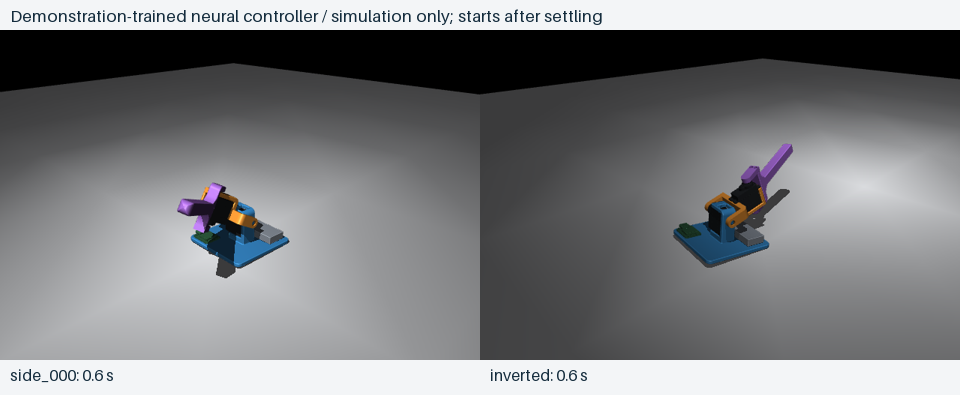

# Two-DOF self-righting robot

A small, 3D-printed robot that uses two perpendicular servo joints and a learned onboard controller to get back upright. Inspired by [Homemade Garbage's project](https://homemadegarbage.com/rl13) and [SelfRisingRobot](https://github.com/homemadegarbage/SelfRisingRobot).

**Current status — 7 November 2026:** controller **0.7**, with a newly trained **C3-matched PPO actor**, is uploaded and armed for standalone operation. The simulator includes the installed thicker electronics enclosure and outward battery position. Physical C3 recovery is awaiting operator observation; earlier hardware self-righting used the earlier build.

**V1 development history.** Earlier hardware demonstrated unassisted self-righting and battery-only recovery. Controller **0.7** replaces the original actor with the C3 candidate, retaining **0.6** automatic battery-only startup and the **0.5** one-minute inactivity lock. [Deployment record](firmware/policy_control/results/2026-11-07/deployment_0_7.json).

- **[Operating instructions](docs/OPERATING_INSTRUCTIONS.md)** — run without a computer, stop, charge, wake after inactivity.
- **[Project summary and video facts](docs/PROJECT_SUMMARY.md)** — what was built, how the controller learned, demonstrated results and remaining limits.
- **[Complete wiring](electrical/FROM_SCRATCH.md)** — [schematic PDF](electrical/REV_C_WIRING.pdf), [PNG](electrical/REV_C_WIRING.png), [phone map](electrical/REV_C_PHONE_WIRING.png).
- **[Build BOM](BOM.md)** · **[CAD and enclosure](cad/electronics_pod/README.md)** · **[Controller firmware](firmware/policy_control/README.md)**.



## Everyday use

**Run:** unplug USB, slide the Pololu OFF and then ON. Keep the base still for initialization and allow joint clearance: after about two seconds it commands neutral for one second, then starts recovery. A fresh IMU/filter and approximately 3.7–4.4 V BAT reading are required.

**Idle:** 60 seconds without meaningful movement at the base IMU stops PWM and locks motion until reboot. Moving it or reconnecting USB does not wake it. To wake, unplug USB and cycle OFF → ON.

**Charge without a computer:** start fully off with USB unplugged and slider OFF. Connect USB, then slide ON. USB power at startup selects motionless charge mode; the switch must be ON to connect the cell to the charger. Unplugging USB alone does not restart motion. For storage, unplug USB and slide OFF.

Connecting USB to an already-running robot does not itself stop it. Wait for inactivity, explicitly stop/charge from the Mac, or start the USB-at-boot charging sequence above. PWM-off leaves the electronics and servo idle loads powered; through-switch charging current and termination have not been measured.

Optional Mac controls, from the repository root:

```sh
./robot status   # Read state without stopping motion
./robot stop     # Stop PWM; cancels pending automatic startup
./robot charge   # Stop PWM and hold charge mode; retains any inactivity lock
./robot arm      # Explicit bench override; cannot clear an inactivity lock
```

## Hardware

| Part | Role |
|---|---|
| XIAO nRF52840 Sense, headers removed | Runs inference; onboard six-axis IMU, battery ADC and USB-C LiPo charger |
| Two PTK 7465 MG servos | Move the arm; ordinary PWM commands, no joint-position telemetry |
| One 500 mAh 1S LiPo | Powers controller and servos; no boost converter |
| One Pololu 2810 LV | Manual battery master switch; ON/SW pads and XIAO D2 unused |
| PLA arm and under-base cup/lid | Mechanical structure and electronics packaging |

Lower PWM is **D8 / printed 8**, upper **D7 / printed 7**. Servo power comes from the switched battery bus, never the XIAO's 3V3 output. The [hardware guide](HARDWARE.md) explains sensing, power paths and measured versus assumed parameters. Receipt totals are incomplete; the original under-$100 target is not a verified total.

The latest printable cup is **C3** with a tighter USB opening and outward battery placement; its lid is unchanged from fit-approved **C2**. The [deployed training model](sim/enclosure_c3/README.md) uses frozen installed C3 inputs; the earlier [C2 simulator](sim/enclosure/README.md) remains preserved separately. The original arm is from the user's [final Onshape export](cad/onshape_import/README.md); older generated arm concepts are historical.

## Learning and simulation

The deployed actor is a **10 → 64 → 64 → 2** network with **4,994 float32 parameters**, evaluated onboard at **50 Hz**. It observes estimated base DOWN, gyro, commanded joint targets and previous actions. It outputs target increments; simulated servos have finite speed, lag and torque. Actual joint angles are not policy inputs.

The current actor uses **Stable-Baselines3 PPO**, warm-started from the C2 candidate on the installed C3 model. The run completed **202,752 new transitions / 206 episodes**; the selected checkpoint is at **33,792 transitions / 34 completed episodes**, with seven checkpoints saved. In 50 held-out simulated cases it restored a stable base in **49/50**, versus **36/50** for the old actor on the same cases within 15 seconds. It often rests with a bent arm: strict straight-arm success is **0/50**. These are simulation results. [C3 training, selection and limits](sim/enclosure_c3/README.md). The [original experiment](sim/recovery/README.md) supplied an earlier demonstration-trained actor.

For the current C3 actor's mouse-force playground on this configured Mac:

```sh
ROBOT_MODEL_PATH="$PWD/sim/enclosure_c3/robot.xml" .venv-sim/bin/mjpython sim/recovery/play.py \
  --model sim/enclosure_c3/results/best.zip --filtered
```

Double-click a body, then Control + right-drag to pull; release to watch recovery. Drag normally to orbit and scroll to zoom. This opens simulation only. [Full setup and model guide](sim/README.md).

| Model/experiment | Status |
|---|---|
| Original Onshape geometry + demonstration-trained actor | Historical deployment; physical self-righting observed |
| Original actor's broad simulation evaluation | 100/100 in that specific historical suite; not a hardware success rate |
| C2 enclosure, relocated IMU and corrected adjacent contacts | Separate offline candidate; 18/30 fresh randomized cases versus old actor's 8/30 on the same new-model cases |
| Installed C3 cup/battery layout + new PPO actor | Current controller 0.7; 49/50 held-out simulated stable-base recoveries; physical result pending |

## Reproduce and inspect

- **Firmware:** [toolchain setup](firmware/README.md), [current controller](firmware/policy_control/README.md), [validation history](firmware/VALIDATION.md).
- **Geometry:** [final Onshape import](cad/onshape_import/README.md), [enclosure sources and print package](cad/electronics_pod/README.md), [original mass accounting](sim/mass_properties/README.md).
- **Training:** [pipeline](sim/README.md), [current C3 actor](sim/enclosure_c3/README.md), [original actor experiment](sim/recovery/README.md), [C2 experiment](sim/enclosure/README.md).
- **Decisions:** [controller/IMU](docs/CONTROLLER_DECISION.md), [servo feedback tradeoff](docs/SERVO_DECISION.md), [procurement history](docs/PROCUREMENT_STATUS.md).
- **Future iterations:** [integrated controller PCB](docs/INTEGRATED_CONTROLLER_PCB.md), [battery LED and hardware backlog](docs/HARDWARE_BACKLOG.md), [persistent recovery/personality](docs/RECOVERY_BEHAVIOR.md).

CAD revisions, raw captures, source hashes and checkpoint histories are retained. Build outputs, downloaded toolchains, virtual environments and local training runs are ignored by Git. Hardware demonstrations establish a working experimental build, not guaranteed recovery from every fall, measured servo dynamics or a completed charging qualification.
