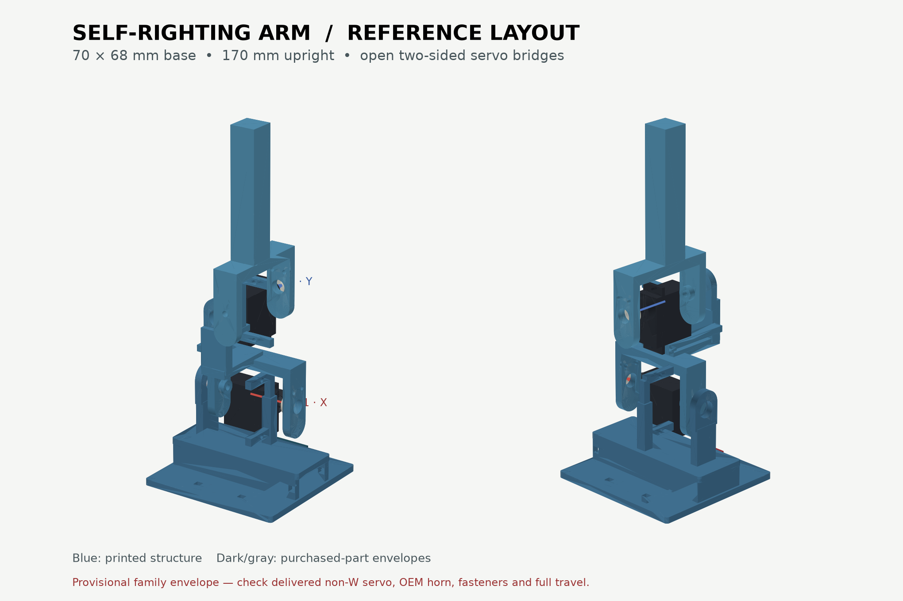

# CAD: open reference layout for PTK 7465 MG

This revision follows the structure visible in the [reference photos](https://homemadegarbage.com/rl13) and [four reference STL parts](https://github.com/homemadegarbage/SelfRisingRobot/tree/main/3Dmodel): flat foot, lower exposed servo, stepped middle crank, upper exposed servo, and long straight upper arm. The previous rectangular cages and round arm disks are gone. The geometry here is newly parameterized in `build_cad.py`; it does not include or redistribute the source STL meshes.



The difference from the source robot is deliberate. Our ordered **500 mAh pouch** needs a 70 × 68 mm base with a 67 mm long, 21 mm wide, 10 mm high center tunnel. Both joints also have a passive rear **MR83ZZ bearing and 3 mm pin** opposite the driven horn. Those four small hardware pieces are *proposed* and were not in the reported purchases. The moving part at each hinge is an open U: one rounded horn tab, one rounded rear tab, and a 12.5 mm wide bridge over the servo. The motor case stays visible. The middle link steps sideways to connect the two perpendicular joints; the upper pole starts at the center of its bridge.

| Printed part | Files | What it carries |
|---|---|---|
| Base | `base.step`, `base.stl` | Flat foot, battery tunnel, exposed lower-servo ear mount, rear bearing post, controller and switch shelves |
| Middle link | `middle_link.step`, `middle_link.stl` | Lower moving U, stepped neck, exposed upper-servo ear mount, upper rear bearing support |
| Upper arm | `paddle.step`, `paddle.stl` | Upper moving U and straight 12.5 × 12.5 mm pole |

The [assembly STEP](assembly.step) includes provisional outlines for both servos, OEM horns, bearings, pins, battery, XIAO and switch. Open it in a CAD tool to orbit and inspect it. The [interactive viewer](viewer.html) spins in a browser; drag to rotate, scroll to zoom and use its checkbox to hide purchased-part outlines. The printable STLs are in assembly coordinates; orient each part on the slicer bed.

Joint axes are X at z=42 mm and Y at z=87 mm. The upright tip is z=170 mm, close to the approximately 168 mm reference height. The original reference is lighter and has a smaller battery than this build. The printed structure is a concept until fit and mass are measured; no physical strength or self-righting performance has been demonstrated.

**Fit before final printing.** The ordered PTK 7465 MG is the same model family as the reference servo, but the current dimensions use a 7465-family envelope. The actual non-W case, mounting ears, spline, OEM horn holes and supplied screws must be measured. Print the [servo mount](servo_mount_fit_coupon.stl), [horn tab](horn_fit_coupon.stl), [bearing pocket](pivot_fit_coupon.stl), and [battery tunnel](battery_tunnel_fit_coupon.stl) coupons first; record results in [FIT_CHECK.md](FIT_CHECK.md). The horn tab has a 7.0 mm center opening and two provisional 2.2 mm holes; it attaches to an **OEM horn**, not directly to the spline. Do not force the center screw or assume a universal servo-horn pattern. Check wire exit and screw-head clearance by hand through the full rotation.

The rear bearing pocket is nominally 8.05 mm diameter by 3 mm deep; the moving rear tab has a 3.05 mm blind pin bore. Insert the servo and mount both ear screws before fastening the moving horn tab. Seat only the **outer** bearing ring in its pocket. Set the pin through the bearing and into the moving tab without axial preload; keep adhesive out of the races. Confirm free rotation before powering either joint. Bearing and pin fits depend on printer settings and must be tuned with the coupon.

`nominal_clashes.json` reports no overlap at upright. `motion_check.json` samples 81 poses across ±80° on each joint and reports no nominal rigid-body overlaps. This is a **coarse geometry check**; it excludes real screw heads, the actual horn, wire loops, print tolerance, and continuous motion between samples. The STLs are watertight single-component meshes per `stl_validation.json`. Orient layers for strength at the motor mount posts, bridge roots and bearing cheeks; use at least four perimeters and inspect for flex before powered testing.

Regenerate the CAD and viewer from the repository root:

```sh
python3.12 -m venv .venv-cad
.venv-cad/bin/pip install cadquery==2.8.0 matplotlib
.venv-cad/bin/python cad/build_cad.py
.venv-cad/bin/python cad/check_motion.py
.venv-cad/bin/python cad/validate_stl.py
.venv-cad/bin/python cad/render_preview.py
.venv-cad/bin/python cad/build_viewer.py
```

Keep the CAD environment separate from the training environment because they use different NumPy dependency ranges.
