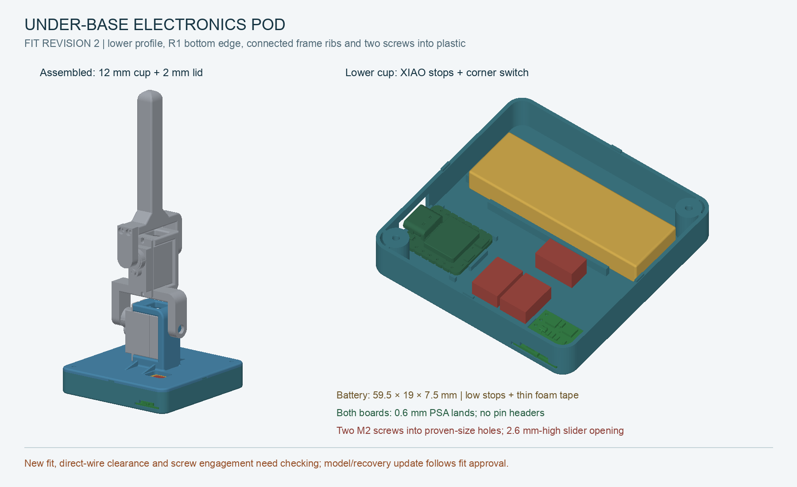
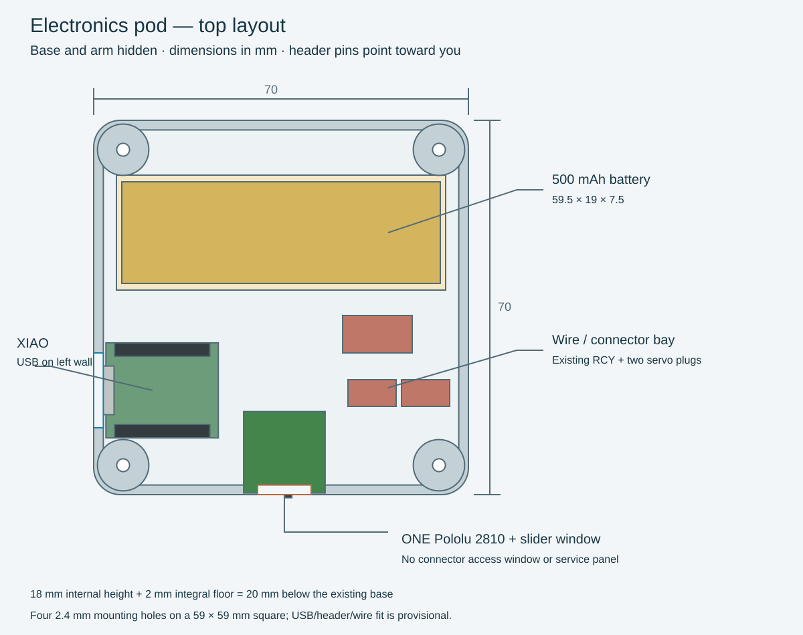

# Current CAD — C3 robot

**[Download the complete robot STEP](assembly.step)** · **[Download the enclosure print package](electronics_pod/rev_c3_print_fit.zip)**

`assembly.step` is the latest complete assembly: the Onshape-designed arm, thin lid/servo mount, C3 electronics cup, both servos, battery, XIAO and one Pololu switch. It includes the XIAO locating stops, tight USB opening and battery against the side wall shown in the build video. Units are millimetres.

*The STEP contains the complete robot shown at left. The enclosure ZIP contains the cup/lid print files and the full assembly STEP. Hardware models and red connector envelopes show the intended layout; they are not printed parts.*

| What you need | Current files |
|---|---|
| Complete robot, including individual arm components | [Assembly STEP](assembly.step); import it into your CAD tool and export the required printed bodies |
| Enclosure cup | [STL](electronics_pod/electronics_cup.stl) · [STEP](electronics_pod/electronics_cup.step) |
| Lid with lower-servo mount | [STL](electronics_pod/base_modified.stl) · [STEP](electronics_pod/base_modified.step) |
| Enclosure layout and interactive preview | [Enclosure guide](electronics_pod/README.md) · [Viewer](electronics_pod/viewer.html), download and open locally |
| Printing and assembly | [Print/fit guide](electronics_pod/PRINT_FIT_CHECK.md); two M2 × 10 mm screws into plastic |
| Training geometry and joint motion | [Current C3 simulation](../sim/README.md) |

*Lid removed: battery along the rear wall, XIAO beside the USB opening, and Pololu switch at the front corner. Dimensions are in millimetres.*

The enclosure fits a **headerless XIAO nRF52840 Sense**, E-flite 500 mAh 1S battery and Pololu 2810. Other XIAO variants, including nRF54L15 Sense, have not been fit-checked.

The [Onshape import](onshape_import/README.md) is an input to the current assembly generator; it predates the under-base enclosure and is not the complete current robot. The original Onshape document has not been updated with the generated enclosure changes.

Superseded CAD downloads and concept generators have been removed. Older versions remain available in Git history; frozen geometry under `sim/` remains with its training experiments for reproducibility. The current STEP and C3 training snapshot use identical cup/lid geometry.

[Wiring](../electrical/FROM_SCRATCH.md) · [Documentation index](../docs/README.md)
