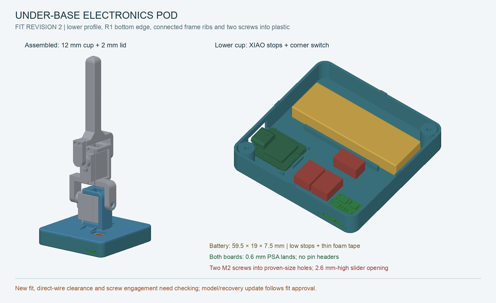

**Fit approved by the user on 3 November 2026.** New slicer masses and physics are in [the enclosure MuJoCo model](../../sim/enclosure/README.md). Wiring/charging commissioning remains pending.

# Lower enclosure — fit revision 2 (Rev C2)

**Prepared 3 November 2026 after the first physical fit.** The battery fit is retained; the XIAO now has locating stops and both boards have low PSA lands. The Pololu moves to the opposite front corner. The user confirmed **headers removed** and **M2 × 10 mm screws into plastic, no nuts**. Electrical wiring remains Rev C and packages **ONE Pololu**.

**[Download the new print package](rev_c2_print_fit.zip)** and follow the [fit instructions](PRINT_FIT_CHECK.md). The new matched prints are **[cup STL](electronics_cup.stl)** and **[thin lid / servo mount STL](base_modified.stl)**. `rev_c_print_fit.zip` is a backward-compatible alias of the latest package, not the old print.



## Geometry

| Feature | New revision | Previous fit |
|---|---|---|
| Footprint | 70 × 70 mm; retained battery stop XY positions | 70 × 70 mm |
| Cup body depth | **12 mm**, plus 0.8 mm register tabs entering lid pockets | 20 mm |
| Lid plate | **2 mm**; original servo frame retained, root gussets added | 4 mm |
| Closed electronics package | **14 mm** | 24 mm |
| Cup walls / floor | **1.2 / 1.6 mm** | 1.8 / 2.0 mm |
| Outside ground-contact edge | **1 mm radius**, flat central bottom retained | Square bottom edge |
| Board retention | Locating stops + **0.6 mm broad PSA lands**, nominal 0.4 mm insulating tape | Tall/narrow supports; no XIAO stops |
| Switch opening height | **2.6 mm**, plus shallow PCB-edge relief | 6 mm |
| Lid fasteners | **Two diagonal M2 × 10 screws**, blind 2.0 mm bores matched to the working model, no nuts | Four screws + four nuts |
| Header accommodation | None; direct solder wires | Tall pin headers |

The four small cup registration tabs enter shallow pockets under the lid, helping locate edges with only two screws. They do not require flexing snap clips. The two screw bosses have 8.6 mm blind pilots; nominal screw engagement is 8 mm through the 2 mm plate. The bore diameter is copied from the existing printed horn-bracket screw holes (1.0 mm cylindrical radius, 2.0 mm nominal diameter) in the user-supplied Onshape export. The user confirms these fit the screws in use, so **no new coupon or alternate pilot-size trial is included**. No nuts, inserts or extra electronic hardware are added.

All four lid gussets now overlap the actual servo-frame walls above the plate. The build checks each connection separately and verifies that the cable opening does not cut any gusset away. The cup's outside bottom perimeter has a **1 mm fillet**, including the rounded corners; most of the bottom remains flat.

The lower cup leaves less space beneath boards. PSA attaches to broad low lands, with relief gaps for underside joints. Route Pololu wires **from its upper/component side**; do not count on the old 3 mm underside allowance. Check XIAO BAT solder and tape thickness before seating it. Internal plugs are arranged flat in the central bay; no routine connector-access window or separate service panel is added.

## Review and editable files

- [Interactive 3D viewer](viewer.html): whole robot, top layout, front switch and thin-lid-only views; visibility and explode controls.
- [Dimensioned layout](layout.svg), [complete STEP assembly](assembly_review.step).
- Editable [cup STEP](electronics_cup.step), [lid STEP](base_modified.step).
- [CAD checks](validation.json), [watertight STL checks](stl_validation.json), [first-fit reference](fit_revision_1_reference.json).

Cup and lid CAD volume totals **25,763 mm³ instead of 45,602 mm³**, a **43.5% solid-volume reduction**. At uniform solid PLA density 1.32 g/cm³ the reference masses are 16.5 g cup and 17.5 g lid; these are **not slicer estimates**. Use actual slice/scale results for model inertia.

The lid upper face and servo-frame/axis coordinates are retained; the lower side of the old plate is removed. Gussets have no overlap with imported servo/link solids in the neutral assembly. This is not a continuous motion/impact test. New ground is CAD Z=−12 mm, upright tip Z=151 mm, overall height about 163 mm. The cup STL is 12.8 mm high because of its registration tabs; the matched lid recesses receive those tabs. The lid STL remains 35 mm tall including the servo frame, despite the plate being only 2 mm.

## Checks and limits

Both prints are valid single-solid BReps and watertight single-component STLs. Pairwise cup/lid/battery/XIAO-envelope/Pololu/connector checks passed. The detailed controller BRep is invalid in the user source, so clearance uses a containing envelope verified against every source mesh vertex. Slider travel has an extra ±2 mm lateral CAD allowance. Actual PSA, underside chips/solder, cable overmoulds, direct-wire bends, screw torque/pullout and lid stiffness must be checked physically.

Source Onshape geometry and model weights are unchanged; derived lid/cup geometry lives here. The new IMU height, mass distribution and contact shape still require a later model update and recovery evaluation after fit approval. No firmware or robot motion changed in this mechanical revision. Existing [Rev C wiring and charging limitations](../../electrical/README.md) still apply.

## Reproduce

```sh
.venv-cad/bin/python cad/electronics_pod/build_pod.py
.venv-cad/bin/python cad/electronics_pod/build_preview.py
python3 cad/electronics_pod/validate_prints.py
python3 cad/electronics_pod/package_fit.py
```

Pololu uses the user-supplied manufacturer STEP in [source/pololu_2810.step](source/pololu_2810.step). File hashes and offsets are in validation.json. Bore-size provenance is recorded in validation.json.
