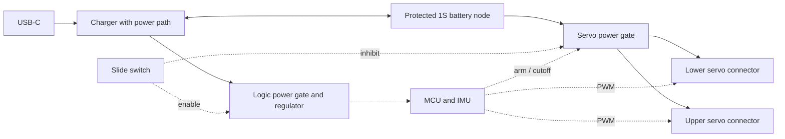

# Future integrated robot controller PCB

Feasibility note, 3 November 2026. The user proposes replacing both the XIAO Sense and Pololu module with one inexpensive board containing all robot electronics, with the battery and two servos plugging directly into it. This expands the earlier carrier-PCB idea. It is a future iteration: no current wiring, purchase BOM, firmware or simulated mass is changed by this note. No fabrication files or supplier quote exist yet.

## Feasibility and compute requirement

Yes: a single PCB can contain the processor, six-axis IMU, USB interface, battery charger, regulation, power switching and connectors. It still needs several ICs and their support components; the manufacturer would assemble those tiny parts. The only external electrical assemblies would be the battery and two servos with their leads.

Our saved actor has 4,994 float32 parameters, **19,976 bytes of weights**, ten inputs and two outputs at 50 Hz. Existing nRF52840 firmware 0.3 reports **85,900 bytes flash and 7,880 bytes static RAM**. Static RAM is not peak runtime RAM: stacks, heap, USB buffers, interrupt nesting and a future larger policy need headroom. Existing nRF hardware measured about 1.2 ms inference for the deployed actor; timing on any replacement MCU must be measured independently. Training remains on the Mac.

The savings opportunity includes removing unused radio/RF circuitry, microphone, external storage and development-board overhead. Less memory alone does not determine total cost; assembly, power components and connectors matter. Preserve reliable USB programming, hardware-timed PWM, ADC voltage measurement and an FPU rather than selecting the smallest memory part first.

## Candidate parts, not a frozen BOM

| Function | Initial candidate | Reason / selection gate |
|---|---|---|
| MCU | **STM32G431CBU6**, Cortex-M4F, 170 MHz, 128 KB flash / 32 KB SRAM | USB device, FPU, timers and ADC integrated. Credible cost-focused candidate, but port/build and peak-memory/timing measurements must establish headroom before layout. SRAM is split into main SRAM and CCM; use the actual linker/USB buffer constraints. |
| More memory if needed | STM32F411CE, Cortex-M4F, up to 100 MHz, 512 KB flash / 128 KB RAM | Less memory pressure; compare full assembled price and power rather than assuming G431 is always cheaper. |
| IMU | **LSM6DS3TR-C** | Keep the sensor already used by our filter/firmware, with its own on-PCB I2C/SPI connection. Mount axes and location still require calibration. |
| Charger / power management | **BQ25185** or BQ24074-class power-path charger | Separate system supply from cell charging; exact part depends on current, thermal budget, charge behavior and assembly quote. |
| Logic supply | Low-quiescent-current LDO | Logic/IMU use regulated voltage; select dropout and brownout margin at the minimum allowed cell voltage. No servo boost converter planned. |
| Power switching / cell protection | Suitable low-resistance MOSFETs/load switches and cell protection | Real electrical servo cutoff, switched logic supply, reverse-current/backfeed control and independent undervoltage protection. Exact current rating must follow measured simultaneous servo demand. |
| Interfaces | USB-C, battery connector, two three-pin servo connectors, one slide switch, status LED, reset/boot and SWD pads | Direct connections; compact right-angle servo headers are a layout option. Retain recovery/programming access even with bad application firmware. |

[G431 specifications](https://www.st.com/en/microcontrollers-microprocessors/stm32g431cb.html), [F411 specifications](https://www.st.com/en/microcontrollers-microprocessors/stm32f411ce.html), [IMU](https://www.st.com/en/mems-and-sensors/lsm6ds3tr-c.html), [BQ25185](https://www.ti.com/product/BQ25185), [BQ24074](https://www.ti.com/product/BQ24074). These are component capabilities, not a validated combination.

RP2350 is another credible low-cost FPU/USB alternative, but its memory/clock/power support and firmware port must be included in the comparison; more memory can still be cheaper overall. It is a microcontroller, not a Linux Raspberry Pi. [Manufacturer specifications](https://www.raspberrypi.com/products/rp2350/). Do not add wireless unless a real use case justifies its cost/layout/power: the currently implemented robot functions use USB and do not require Bluetooth or Wi-Fi.

## Improve the power behavior while integrating

Conceptual electrical blocks, not an implementation schematic:

The charger remains connected to the protected battery node even when robot loads are switched off. USB detection can power the logic for programming while the physical OFF position inhibits motors. Servo signals must stay LOW/isolated when their supply is off so they cannot back-power the servos. Default boot, charging and a firmware fault should leave the servo gate disabled.

| Desired state | Behavior target |
|---|---|
| OFF, no USB | MCU and both servos electrically off. Only specified charger/protection/gate leakage remains; this is not mathematically zero cell drain. |
| OFF, USB attached | Battery charges; MCU may run for programming/status; servo power remains off. No software charging command required. |
| ON, battery only, explicitly armed | Existing autonomous recovery loop. Firmware can physically remove servo power after low voltage or a fault. |
| USB attached | Default to motors electrically disabled and charging/programming. Any later USB-powered motion/service override is a separate design decision. |

Power-path chargers can supply approximately 4.4–4.5 V on SYS with USB present. **Do not simply connect that SYS output to the existing direct-1S servo rail.** Proposed motor power is the protected battery node through its own gate; ensure it is disconnected during charging so motor current does not defeat cell-current accounting/termination. The logic alone uses the managed SYS supply. Validate USB backfeed and every switch/USB combination.

Charging at 500 mA can be a design target for the 500 mAh cell, subject to its permitted charge rate, USB source/current negotiation and enclosure thermal tests. At a 3.5 V cell, a linear charger delivering 0.5 A from 5 V dissipates roughly **0.75 W**, before other losses. A charger rated 1 A does not guarantee that rate is thermally achievable in this cup. Actual battery temperature sensing and low-voltage protection need to be resolved in the circuit, rather than assumed from software.

## Cost reality

Engineering targets, **not supplier quotes**:

- About **$6–12 of electronic components per board**, excluding bare PCB, assembly, shipping, tax and development effort. This includes MCU, IMU, power management/protection, USB, connectors, switch and support components. Do not interpret this as the delivered cost of one working board.
- Budget roughly **$15–30 per assembled board for an initial five-board prototype batch**, or $75–150 total, as a provisional allowance. Actual quantities, QFN inspection, part loading/minimums, PCB stackup and shipping can move it outside that range. A respin costs another batch.
- A repeat batch could beat the current controller-plus-switch replacement cost; the first batch may not. Current manufacturer listings show XIAO Sense at **$15.90** and Pololu 2810 at **$4.49**, or **$20.39** before shipping/tax. These are comparison prices, not recorded amounts paid by the user. Battery and servo costs remain separate and unchanged.

[Seeed current listing](https://www.seeedstudio.com/Seeed-XIAO-BLE-Sense-nRF52840-p-5253.html), [Pololu listing](https://www.pololu.com/product/2810), [JLCPCB assembly cost structure](https://jlcpcb.com/help/article/pcb-assembly-price). LCSC stock is not a guarantee a part is available at the same price in the assembler's library. Generate the actual fabrication/assembly quote before claiming savings.

## Next work when this side project starts

1. Port the existing filter/actor/control loop to an MCU candidate development board and verify USB, PWM, peak memory, inference latency and fault stops. Preserve the observation and action contract; a processor swap alone need not require retraining.
2. Measure both servos' supply demand and battery sag; select the actual gates, protection and logic dropout margin. Specify the exact OFF/USB behavior and charging thermal budget.
3. Draw a KiCad schematic and derive a stocked, assembly-aware BOM. Compare G431 against a roomier MCU on whole-board cost. Do not shrink a memory budget based only on the old firmware's static-RAM figure.
4. Place the board in the current 70 mm base using CAD. Start around **30–35 mm square as a packaging study**, not a committed envelope. Check battery space, servo connector insertion/height, USB/switch access, rigid IMU mounting and mounting holes. Keep motor return currents out of the IMU/logic return path and provide required local decoupling/bulk capacitance.
5. Review layout, run ERC/DRC and obtain a complete assembly quote; produce Gerbers, BOM, placement file and a 3D fit model. Order only after that review. Board bring-up must establish off-state current, charging/termination, real servo cutoff, brownout behavior and USB operation before running a learned controller.
6. Update simulator mass/COM and IMU placement from the built board, then evaluate whether retraining is needed.

The capacitors/resistors are normal factory-assembled PCB parts, not a return to loose external wiring. The intended user experience is one battery plug, two servo plugs, USB and a switch.
