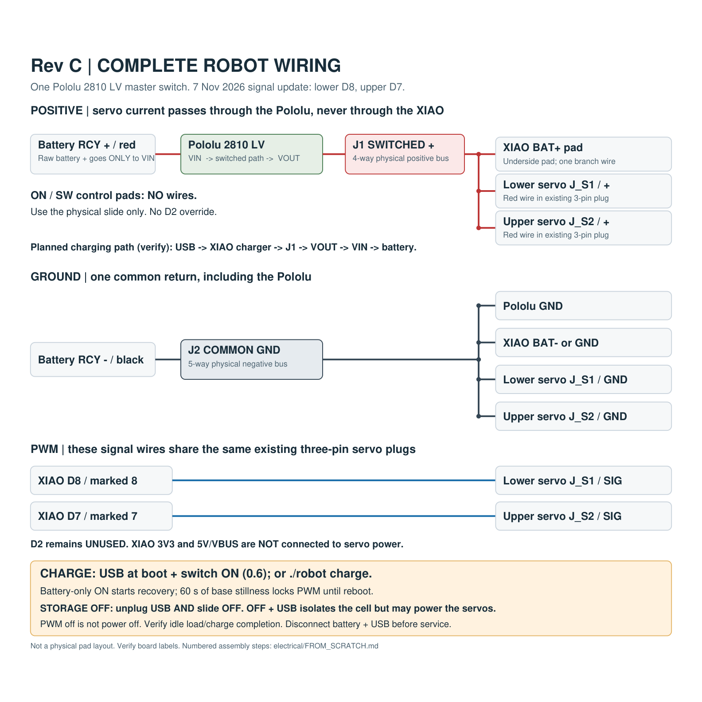

# Wire the complete robot — Rev C

Fresh-build instructions, updated 7 November 2026: **lower signal D8 / 8; upper signal D7 / 7**, as wired by the user. Use **one Pololu 2810 LV** as the battery master switch, the XIAO nRF52840 Sense, two PTK 7465 MG servos and the existing 1S battery. This is the selected harness for the fit-approved enclosure. Physical assembly and through-switch charging have not yet been commissioned.

**Unplug both the battery and USB before soldering.** Leave the three-pin servo plugs unplugged until the initial controller check. The slider alone does not isolate every possible source when USB is connected.

[Full-size PDF](REV_C_WIRING.pdf) · [Full-size image](REV_C_WIRING.png) · [Phone map](REV_C_PHONE_WIRING.png)

## Make two small buses

**J1** and **J2** are names for two physical insulated junctions, not additional boards or required purchased connectors. Use your existing compact solder buses/pads, or short tinned-copper splices with each junction separately insulated. Keep positive and ground separated and provide wire strain relief. Never use the XIAO BAT pad itself to distribute servo current.

- **J1, switched positive:** four branches — Pololu VOUT, XIAO BAT+, lower servo positive, upper servo positive.
- **J2, common ground:** five branches — battery negative, Pololu GND, XIAO GND, lower servo ground, upper servo ground.

## Connect these twelve wire branches

| Wire | From | To | What it does |
|---|---|---|---|
| 1 | Battery connector positive | **Pololu VIN** | Raw battery input. This is the only destination for battery positive. |
| 2 | **Pololu VOUT** | **J1 positive bus** | Switched power for the whole robot. |
| 3 | **J1** | XIAO underside **BAT+** | Powers the controller and connects its onboard charger to the switched rail. |
| 4 | **J1** | Lower servo **positive / red** | Supplies the lower servo motor directly from the switched rail. |
| 5 | **J1** | Upper servo **positive / red** | Supplies the upper servo motor directly from the switched rail. |
| 6 | Battery connector negative | **J2 ground bus** | Battery return. |
| 7 | Pololu **GND** | **J2** | Switch-board ground reference. |
| 8 | XIAO **GND** | **J2** | Controller return; underside BAT− can be used instead. Only one is required. |
| 9 | Lower servo **ground** | **J2** | Lower motor return and PWM reference. |
| 10 | Upper servo **ground** | **J2** | Upper motor return and PWM reference. |
| 11 | XIAO **D8**, marked **8** | Lower servo **signal** | Lower-joint PWM. |
| 12 | XIAO **D7**, marked **7** | Upper servo **signal** | Upper-joint PWM. |

The existing three-pin servo plugs each carry one positive, one ground and one signal; do not add a second ground cable alongside them. Ground is commonly brown/black and signal yellow/orange on hobby servos. Identify the actual received lead assignments before connecting; connector orientation is not defined by this drawing. Check battery-connector polarity too.

The former D0/0 and D1/1 signal pads are now unused. **Leave these pads unconnected:** XIAO **D2 / 2**, **3V3**, **5V**; Pololu **ON** and **SW**. Do not connect D2 to ON. No separate IMU wiring is needed: the IMU is already on the Sense board. USB-C uses the existing cable for programming and charging.

The complete motor-current path is battery + → VIN → Pololu → VOUT → J1 → servo → J2 → battery −. Motor current does not pass through XIAO power traces.

## Assembly order

1. With battery and USB absent, position the boards and battery in their locating stops. Keep the battery unplugged throughout soldering.
2. Build/insulate J1 and J2. Connect the twelve branches above. Leave enough flex for the lid and both joints, without loose wire entering a hinge or blocking the USB opening/slider.
3. Inspect polarity and solder joints. Check ground continuity between J2, both boards and servo ground contacts. Check there is no persistent low-resistance positive-to-ground short. A brief capacitor-charging response on a resistance meter is not by itself a short.
4. For the first USB-only controller check, leave battery and **both complete servo plugs disconnected**. Controller 0.6 is uploaded; use it for a fresh build. USB-at-boot selects PWM-off charge mode, while battery-only boot automatically starts recovery after initialization. Older controllers use D0/D1 and must be replaced before arming or charging with this harness.
5. With USB removed and servos still disconnected, test battery-only power: slider OFF should leave the XIAO off; **ON now triggers automatic recovery startup after about three seconds**. Keep clearance even when testing with the servo plugs disconnected. Remove battery power again before reconnecting servo plugs.
6. Complete the supervised checks in the [commissioning guide](README.md#commissioning-the-new-harness), including no-PWM charging current and charge completion, before sealing the cup.

## How the finished harness operates

| Purpose | Physical switch | USB | Software |
|---|---|---|---|
| Run on battery | OFF → ON | Unplugged | Automatic startup in 0.6; no computer needed |
| Charge | **ON** | Present at startup | Automatic CHARGE in 0.6; `./robot charge` is an optional override |
| Fully off / store | **OFF** | **Unplugged** | None |

In charge mode PWM stops, but both servos still have electrical power. Charging through the enabled Pololu is inferred from its schematic and must be verified on this harness; servo idle current reduces current available to the cell. USB connected does not guarantee net charging. With the slider OFF, the battery is isolated and **cannot charge**; USB can still power the XIAO/shared output rail.

[Electrical rationale and manufacturer sources](README.md#reproduction-and-sources) · [Operating instructions](../docs/OPERATING_INSTRUCTIONS.md)
