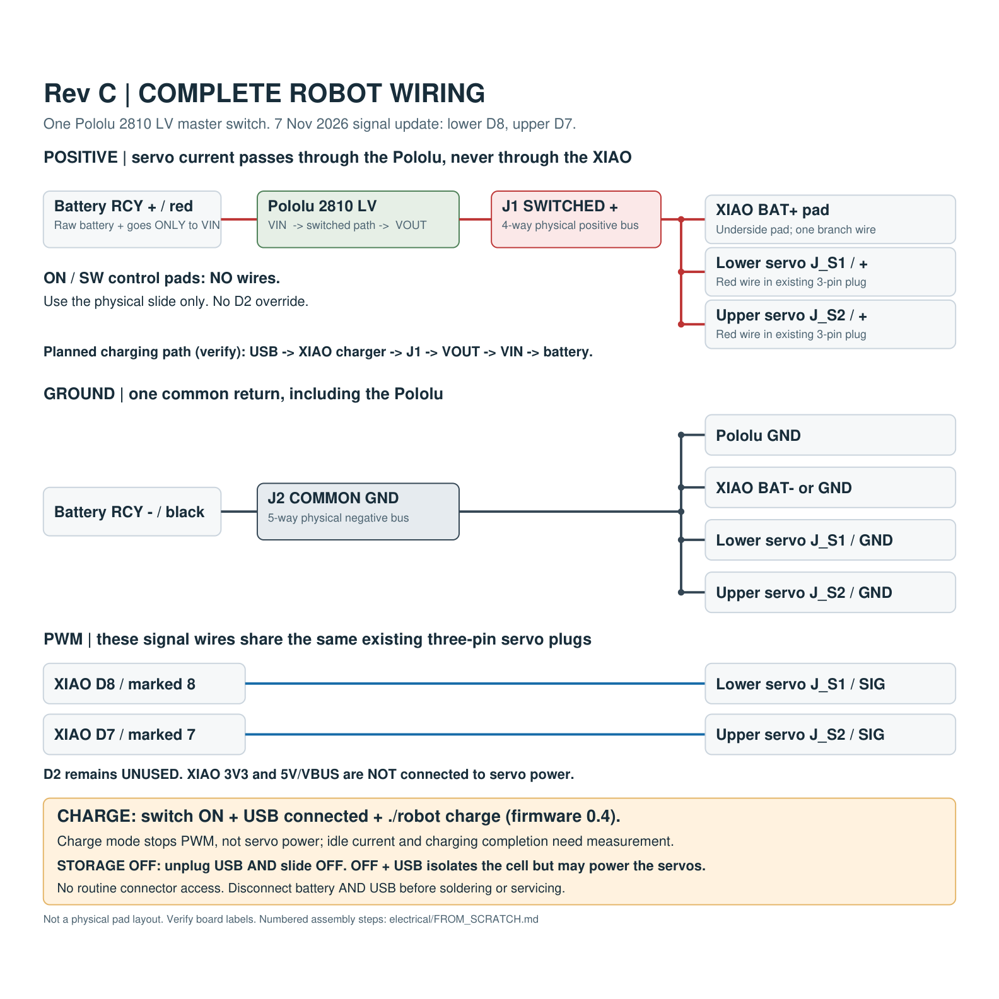

# Rev C — one Pololu battery master switch

**Selected 2 November 2026; prepared, not physically rewired or bench-validated.** The last confirmed live harness is [Rev B](REV_B_NOTES.md). Rev C reinstalls **one existing Pololu 2810 LV** upstream of both the XIAO and servos. No second switch board, charger, MOSFET, diode, resistor or capacitor is added. D2 stays unused.

Open the [complete schematic PDF](REV_C_WIRING.pdf), [SVG](REV_C_WIRING.svg), [PNG](REV_C_WIRING.png), or [large-text phone map](REV_C_PHONE_WIRING.png). These are connection maps; use the physical board's printed pad labels, not drawing positions.



## Every connection

| Physical net / wire | Join these points | Purpose |
|---|---|---|
| Raw battery positive | Battery RCY pigtail **+ → Pololu VIN only** | The battery is isolated from every load when the switch is OFF and USB is absent. Remove the former direct battery-to-J1 wire. |
| **J1 SWITCHED+, 4-way bus** | Pololu **VOUT**, XIAO underside **BAT+**, lower servo red, upper servo red | Powers the controller and both servos through one switch. Each servo draws through the bus, not through XIAO traces or the BAT pad. |
| **J2 common GND, 5-way bus** | Battery negative, Pololu **GND**, one XIAO **GND or BAT−**, both servo grounds | Common return. Negative is not switched. |
| XIAO **D0 / marked 0** | Lower servo signal | Lower PWM. |
| XIAO **D1 / marked 1** | Upper servo signal | Upper PWM. |
| XIAO **D2 / marked 2** | **No wire** | No software switch override. |
| Pololu **ON** and **SW** control pads | **No wires** | Operate only the board's physical slider. Do not connect D2 to ON. |
| XIAO USB-C | Existing USB cable | Programming and onboard charging. No wire from 5V/VBUS or 3V3 to either servo. |

Each existing servo plug still carries positive, ground and signal. The battery RCY and servo plugs remain **inside** the cup for service, with no routine need to reach them through a window. The [cup layout](../cad/electronics_pod/README.md) exposes only the USB port and one slider. The Pololu is supported on low insulated PSA lands and locating stops in the corner; never use its electrical pads as mounting holes.

## Switch and software states

| Switch | USB | Software | Result |
|---|---|---|---|
| ON | Absent | Explicitly armed | Battery powers XIAO and servos; standalone recovery continues. |
| ON | Connected | **`./robot charge`** | PWM detached and D0/D1 LOW. The onboard charger is connected to the battery through the Pololu. Servos still receive power and can consume idle current. |
| OFF | Absent | Any | Battery isolated from XIAO and servos; only switch leakage and cell self-discharge remain. |
| OFF | Connected | Any | Battery isolated, so **it cannot charge**. USB can still power the XIAO and shared servo rail through the charger. This is not full OFF. |

**Storage OFF = unplug USB + slide OFF. Charging = slide ON + USB + software charge mode.** Software mode 5 indicates PWM inhibition, not measured positive battery current, a physical servo cutoff or a fuel-gauge result. The charger operates automatically when USB is present; the command stops motion rather than enabling the charger IC.

## Rewire and commissioning

1. Unplug **battery and USB**. Open the cup/base and unplug the servo plugs while soldering and doing the first USB-only firmware upload.
2. Break the existing battery-positive-to-J1 connection. Route battery positive to **VIN**, then **VOUT** to the existing J1 positive bus. Leave the existing J1 branches to BAT+ and servo red wires in place. Do not bypass the Pololu with a second battery-to-BAT+ connection.
3. Add one Pololu GND branch to J2. Keep D0/D1 unchanged and D2/ON/SW unconnected. Insulate joints separately and leave solder/lead bends clear beneath the PCB.
4. With all power absent, check polarity, common-ground continuity and absence of a low-resistance positive-to-ground short. A MOSFET switch is not an ordinary mechanical contact; resistance across VIN/VOUT by itself is not a definitive on/off test.
5. Build/upload controller **0.3** as described in the [firmware guide](../firmware/policy_control/README.md#charging-mode-03). The current task built it but did **not** upload or move the robot.
6. Before closing the enclosure, verify battery-only OFF shuts the XIAO down and ON boots it **disarmed**. Check both servos remain still with no PWM. Then use `./robot charge` with USB and switch ON; confirm mode 5 and no servo pulses.
7. Verify charging current actually reaches the cell through the enabled Pololu, and measure the pair's no-PWM idle load and charge completion/termination. A series current measurement at the battery connection is useful; do not put a meter's current input directly across the cell. USB current or voltage alone does not establish net battery charging.
8. Confirm OFF with USB removed eliminates the ongoing controller/servo drain. Test slider travel and USB insertion before closing the original base over the cup.

Charging through the enabled switch is an engineering inference from the slide board's back-to-back MOSFET schematic, not an observed result on this unit. Pololu separately confirms reverse charging for its related pushbutton switch; that is corroboration, **not an exact-model bench test**. Keep commissioning results separate from the existing recovery evidence.

## Charging limits

The existing XIAO charging configuration remains approximately **100 mA**, selected by `PIN_CHARGING_CURRENT` LOW. Servo idle current and the switch LED consume some of that output; movement can exceed it and discharge the cell while USB is connected. The charger has a shared battery/load output, not a separate managed servo supply.

TI permits a parallel system load provided charging completes within the fixed ten-hour safety timer. Nonzero idle current can also affect termination/indicator behavior. The no-PWM load and complete charging cycle **must be characterized** before treating this as a validated connector-free charging setup. If idle load prevents completion, this one-switch/no-extra-electronics constraint cannot fix that by software alone; revisit the design rather than claim charging is verified.

With switch OFF, the XIAO ADC reads the isolated BAT/charger node rather than the cell. With switch ON it is an approximate cell-voltage reading affected by charging and switch/wire loss. There is no switch-position sensor, current sensor, physical low-voltage cutoff or automatic physical OFF in this revision.

## Reproduction and sources

```sh
.tools/arduino/python/bin/python electrical/render_rev_c.py
```

[Pololu 2810 operation and schematic](https://www.pololu.com/product/2810), [related pushbutton reverse-charging discussion](https://forum.pololu.com/t/charge-lipo-through-mini-pushbutton-power-switch-lv/20861), [XIAO schematic](https://files.seeedstudio.com/wiki/XIAO-BLE/Seeed_Studio_XIAO_nRF52840_PDF.pdf), [Seeed charging settings](https://wiki.seeedstudio.com/XIAO_BLE/#battery-charging-current), and [TI BQ25101 parallel-load/timer limitations](https://www.ti.com/product/BQ25101).

[Rev A](REV_A_WIRING.pdf) and [Rev B](REV_B_NOTES.md) remain historical. Rev A switches only the servos; **do not use its connections for this master-switch revision**.
