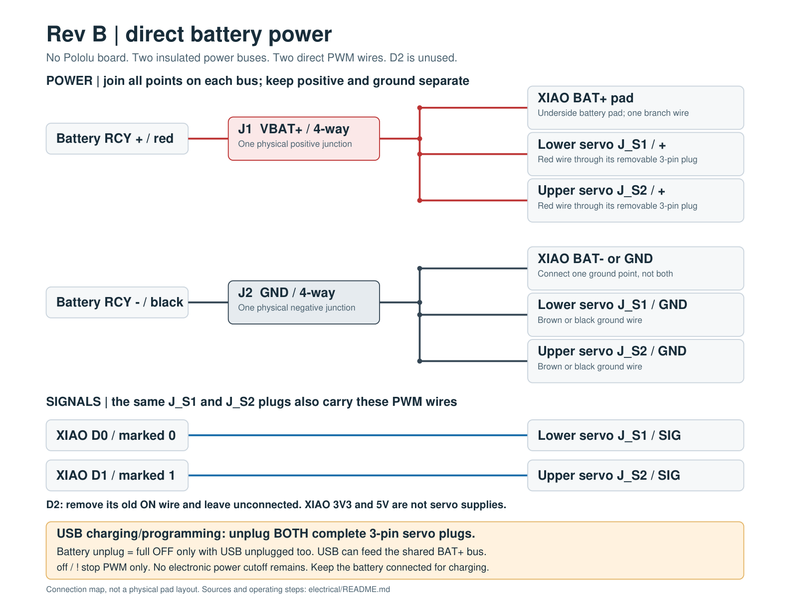

# Rev B electrical wiring - direct battery, no switch

**Current wiring: Rev B, 30 October 2026.** The Pololu 2810 and its D2 control wire are removed at the user's request. Reuse the battery RCY pigtail and both existing removable three-pin servo plugs. No new component is needed.

Open the [one-page PDF](REV_B_WIRING.pdf), [editable SVG](REV_B_WIRING.svg), or [PNG](REV_B_WIRING.png). Phone-sized maps: [power](PHONE_WIRING_POWER.png) and [signals](PHONE_WIRING_SIGNALS.png).



## Every connection

| Physical bus / wire | Join these points | Purpose |
|---|---|---|
| **J1 VBAT+, 4-way** | Battery/pigtail positive, XIAO underside **BAT+**, lower servo red, upper servo red | Direct battery power to all three devices. Keep the two servo plugs removable. |
| **J2 GND, 4-way** | Battery/pigtail negative, XIAO **BAT- or GND**, lower servo ground, upper servo ground | Common return; servo current returns directly to this bus, not through the XIAO. Use one XIAO ground connection. |
| **D0 / marked 0** | XIAO D0 to lower servo signal | Lower-joint PWM. |
| **D1 / marked 1** | XIAO D1 to upper servo signal | Upper-joint PWM. |
| **D2 / marked 2** | **No wire** | Unused; remove the old Pololu ON lead completely. |

Each servo plug still carries **all three wires: positive, ground and signal**. J_S1/J_S2 labels on the sheet identify those same lower/upper plugs across the power and signal sections. Verify actual wire labels/colors. XIAO **3V3 and 5V/VBUS are not connected to either servo**. No external IMU, PWM board, switch, booster, capacitor or resistor is added.

## Rewire from Rev A

1. Disconnect **both battery and USB**. Unplug both servo connectors.
2. Remove the Pololu board and its VIN, VOUT, GND and D2/ON connections.
3. Merge the former J1 battery-positive and J3 servo-positive junctions into **one J1 bus**. Keep the single existing branch to XIAO BAT+; do not route servo power through that pad or the XIAO PCB.
4. Remove the old Pololu ground branch. J2 now joins only battery negative, one XIAO ground, and the two servo grounds.
5. Keep D0 and D1 signal wiring. Keep the removable servo connectors; insulate J1 and J2 separately, strain-relieve the harness, and inspect polarity/shorts with all power removed.
6. Upload the Rev B firmware with the battery and **both complete servo plugs disconnected**, using USB to power the XIAO. The revision is prepared in the repository; it has not been remotely flashed as part of this wiring change.

The existing printed switch shelf can stay empty. No CAD reprint is required to remove the electronics.

## Running, stopping, charging

| Mode | Battery | USB | Servo plugs |
|---|---|---|---|
| Normal robot operation | Connected | Unplugged | Both connected |
| Supervised terminal motion test | Connected | Connected | Both connected; support the arm |
| USB firmware upload / programming | Unplugged | Connected | **Both complete plugs unplugged** |
| Charge through XIAO USB-C | Connected | Connected | **Both complete plugs unplugged** |
| Full OFF / storage / wiring work | Unplugged | Unplugged | Any; disconnect plugs before rework |

**Battery disconnection is the manual OFF control during battery-only operation. With USB connected, battery disconnection alone does not guarantee servo power is off.** The XIAO charger connects to BAT+, which is now also the servo-positive bus. USB can therefore feed that bus even with the battery absent. The charger is not a motor supply; disconnect both full servo plugs for USB-only programming and routine charging. This uses the connectors already on the robot rather than adding another switch or connector.

`off`, `!`, timeout and serial disconnect **stop PWM only** in Rev B. They cannot physically cut servo power, guarantee released holding torque, stop idle drain, or provide a battery low-voltage disconnect. Disconnect battery **and USB** for true power-off. A future low-battery alarm can request manual disconnection; software cannot replace the removed power switch.

For charging, keep the pack connected to BAT+ and GND, remove both servo plugs and connect USB-C. Firmware selects approximately 100 mA; the charge setting and limitations are in [HARDWARE.md](../HARDWARE.md). The brief USB+battery motor-test mode is for supervised commands, not unattended charging.

## Firmware and regeneration

The [bench firmware guide](../firmware/README.md) covers terminal control. Version 0.10 defaults to Rev B direct power, leaves D2 as an unconnected input and makes the stop semantics explicit. Older version 0.3 motion commands can still produce PWM after rewiring, but its power-off wording no longer describes the hardware.

Using the project-local Python environment with `reportlab`, `pymupdf` and Pillow installed:

```sh
.tools/arduino/python/bin/python electrical/render_schematic.py
.tools/arduino/python/bin/python electrical/render_phone_wiring.py
```

## History and sources

The [Rev A PDF](REV_A_WIRING.pdf), [SVG](REV_A_WIRING.svg) and [PNG](REV_A_WIRING.png) are archived switch-based wiring, **not the current build instructions**. Earlier switch tests remain in the [validation log](../firmware/VALIDATION.md); the user has confirmed the Rev B physical rewire is live.

Manufacturer references: [Seeed pinout and battery/USB charging](https://wiki.seeedstudio.com/XIAO_BLE/), [XIAO Sense schematic](https://files.seeedstudio.com/wiki/XIAO-BLE/Seeed-Studio-XIAO-nRF52840-Sense-v1.1.pdf), and [TI BQ25101 charger description](https://www.ti.com/product/BQ25101). The charger has a battery/system output; that shared node is why unplugging the battery is not sufficient isolation when USB remains connected.
