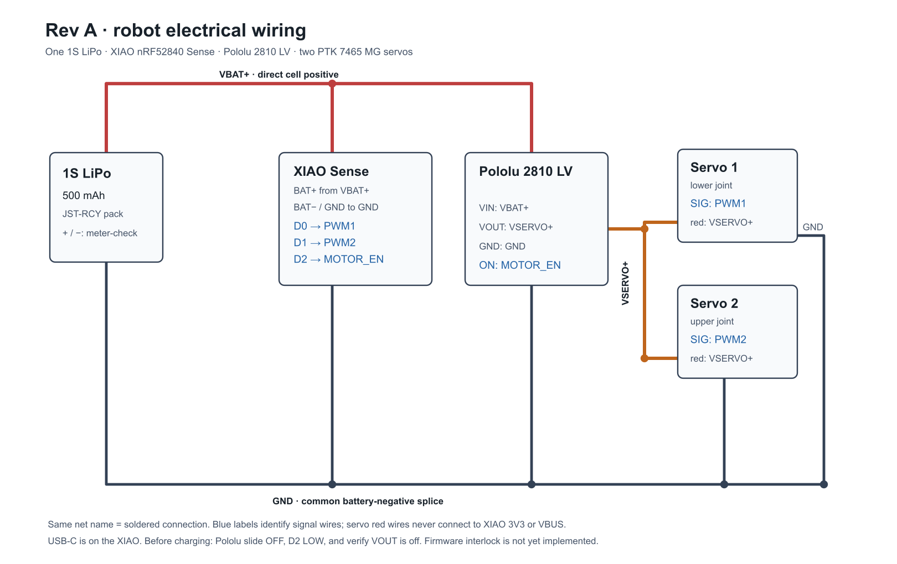

# Rev A electrical schematic and wiring

Open or print [the one-page wiring schematic](REV_A_WIRING.pdf), or view its editable [SVG](REV_A_WIRING.svg) and [PNG preview](REV_A_WIRING.png). It shows **every external wire**, including both servo PWM signals and the D2 switch-control wire. J1, J2 and J3 are three **separate physical power junctions**. The XIAO charger, IMU, regulator and battery-voltage divider are already on the XIAO PCB; the Pololu MOSFET circuit is already on the switch PCB. No separate charger, IMU, boost converter, servo-driver board, resistor or capacitor is needed for the first wiring pass.

**Read the labels on your actual boards before soldering.** This diagram assumes the ordered XIAO **nRF52840 Sense** and Pololu **2810 LV**, not similarly named variants. Verify the JST-RCY mating lead's red/black polarity with a multimeter; connector color and orientation alone are insufficient.

| Physical junction / wire | Join these points | Purpose |
|---|---|---|
| **J1 `VBAT+` bus, 3-way** | Battery/pigtail positive → XIAO underside **BAT+** pad **and** Pololu **VIN** | Feeds the controller and the switched servo branch in parallel. |
| **J2 `GND` bus, 5-way** | Battery/pigtail negative → XIAO underside **BAT−** pad or board **GND**, Pololu **GND**, and both servo ground wires | Common signal reference. Servo return current goes directly to this battery-side junction, not through the XIAO. |
| **J3 `SERVO+` bus, 3-way** | Pololu **VOUT** → both servo positive/red wires | Switched motor power only; never connect this bus to XIAO `3V3`, `5V`, or `VBUS`. |
| `PWM1` | XIAO **D0** → lower servo signal wire | First joint's command. |
| `PWM2` | XIAO **D1** → upper servo signal wire | Second joint's command. |
| `MOTOR_EN` | XIAO **D2** → Pololu **ON** | `HIGH` enables the servo rail when the Pololu slide is physically **OFF**; `LOW` or floating disables it. |

J1 and J2 are the positive and negative buses you identified; J3 is a third bus **after** the Pololu switch, so both servos can share its switched output. A bus here means a common, mechanically supported conductor. J1 and J2 can be short tinned wire splices with their listed leads soldered along them and covered by separate insulating sleeves. The Pololu 2810 has two connected VOUT pads, so J3 can be those pads: solder one servo positive lead to each and omit an external J3 splice. Three mutually isolated copper pad groups on a small piece of perfboard are an alternative if you want a tidier harness; that board is a mounting choice, not another electronic circuit. Keep J1 and J2 near the RCY pigtail and strain-relieve each joint. Never join J1 to J3 except through Pololu VIN→VOUT. The battery-positive branch to the XIAO should carry only board/charging current; the servo current uses the J1→Pololu→J3 path.

## Compact bus construction

The lightest option is an **inline, staggered solder harness** using the 10 cm, 20-AWG male RCY mating pigtail. Work only on this removable pigtail; leave the LiPo's attached leads intact. For J1, run the pigtail's red lead to Pololu VIN and tap a short XIAO BAT+ lead onto it. For J2, use the pigtail's black lead as a continuous ground backbone: make two small, separated taps along it, one for XIAO ground plus Pololu GND and one for the two servo grounds. This spreads the five ground connections across two low-profile joints instead of making one large solder lump. For J3, solder the two servo positive wires directly to the two VOUT pads. The XIAO branches can be thin hookup wire; keep the common battery and servo-current conductors at least as substantial as the existing pigtail and servo leads.

Before soldering, thread appropriately sized heat-shrink tubing onto each lead. Space the exposed junctions along the harness so the insulated bulges do not stack; sleeve **every exposed junction separately**. Fix the harness to the printed base with a tie or printed clip, leaving no solder joint to take cable pull or servo motion. Verify with a meter that the three buses are mutually isolated before inserting the battery. If you expect to change wiring often, a tiny three-island perfboard with reinforced copper/wire for the servo-current paths is easier to rework, but adds a board and mounting space. A terminal block or breadboard is unnecessarily bulky for this build.

The XIAO's **USB-C** port is used for programming and, after charge-mode firmware and electrical checks are complete, for charging the connected 1S battery through its onboard charger. No USB wire is soldered into the harness. The Pololu's physical **OFF** position does **not** force VOUT off if D2 drives `ON` high; its physical **ON** position forces VOUT on. Leave the slide OFF for firmware control. See [power, cutoff and charging details](../HARDWARE.md#battery-monitoring-and-charging).

Before plugging in the battery, check continuity from every point in each row and verify **no short between J1 and J2 or between J3 and J2**. Insulate all three buses separately. Keep the battery-to-switch and switch-to-servo power wires short, and give both moving servo leads strain relief and enough slack through the full joint range. If your servo lead colors differ, identify its `+`, `−` and signal wires from its supplied labeling rather than assuming a color code.

For first power-up, keep the servo horns off and the servos disconnected. Power the XIAO by USB, configure D2 LOW, and confirm the Pololu slide is OFF. Connect the battery only after polarity checks. Measure `VBAT+` at the XIAO BAT pads and confirm Pololu `VOUT` is near 0 V with D2 LOW, then follows battery voltage with D2 HIGH. Return D2 LOW and confirm VOUT falls before connecting one unloaded servo, then the second. **The firmware cutoff and USB charge interlock described in `HARDWARE.md` are still requirements, not implemented features**, so verify VOUT is off before charging through USB-C. Disconnect the RCY pack for storage and a true power-off.

Manufacturer references: [Seeed XIAO nRF52840 Sense pinout, battery and charge instructions](https://wiki.seeedstudio.com/XIAO_BLE/), [Seeed board schematic](https://files.seeedstudio.com/wiki/XIAO-BLE/Seeed-Studio-XIAO-nRF52840-Sense-v1.1.pdf), and [Pololu 2810 pin behavior and schematic](https://www.pololu.com/product/2810).
