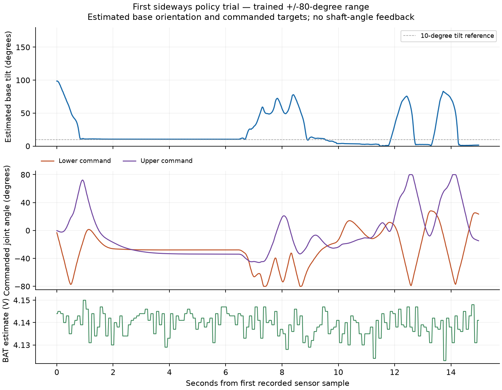

# Learned controller — trained ±80° targets

**Current source: 0.5, 7 November 2026. Lower servo PWM is D8 / printed 8; upper is D7 / printed 7.** This matches the user's new harness. Startup, stop, charge and fault paths drive those same pins LOW; D2 remains unused. The status banner reports the pin assignment. Bench, calibration and sensor-only sketch sources also follow D8/D7. Pin movement changes neither the actor weights, joint order, pulse-to-angle calibration nor training model.

**Uploaded 7 November 2026:** controller 0.5 adds a reboot-only 60-second IMU inactivity latch. See the operating guide for restart and charging. Earlier controller 0.4 replaced 0.2. A 150-frame no-PWM check passed, standalone arming was acknowledged, and the user confirms normal response from both joints. [Deployment and captures](results/2026-11-07/deployment_0_4.json). Mac arm/charge helpers refuse older controller banners so they cannot silently use the old signal assignment. Stop/status remain available for older firmware. Historical captures and version-specific results below retain their original meaning.

This program runs the existing exported actor on the XIAO and can send its outputs to both servos. **Boot is disarmed.** It requires explicit arming, a one-second nominal-neutral hold, and a `run` or `standalone` command. Version 0.3 introduced latched no-PWM charging, included in uploaded 0.4; actual charging acceptance remains pending. Version 0.2 supports explicit Mac arming followed by USB-free operation; see [standalone operation](#standalone-operation-02--arm-from-the-mac). Supervised trials still require a host heartbeat.

The user explicitly chose the trained **±80°** targets rather than restricting the policy to the measured ±45° range. The actor weights, observation normalization, **50 Hz** update rate and **0.06 radian incremental actions** are unchanged. There is no extra slow calibration slew limiter in the learned-control path: the training servo model already permits finite tracking speed/lag.

Both visually measured PWM signs are negative. The deployment profile uses `pulse_us = 1500 - 509.295817894 * angle_rad`, giving approximately **789–2211 µs** over ±80°. This linearly extrapolates the [measured 0°/±45° references](../servo_calibration/results/2026-11-02/visual_mapping.json); it is not an additional angle or end-stop measurement. The original offline measurement converter still refuses extrapolation. `ServoProfile.h` is the separately authorized deployment profile.

## Upload and no-motion check

Unplug the battery and both complete three-pin servo plugs, connect USB, and leave the base still while the gravity filter initializes.

```sh
python3 scripts/robot.py build-control
python3 scripts/robot.py upload-control
.tools/arduino/python/bin/python scripts/control.py --shadow --seconds 10 --out build/control/shadow_01.json
```

Shadow mode runs the same sensor filter, actor and target integration without attaching either PWM output. Its PWM fields must remain zero. The recorder verifies the complete ready/disarmed firmware banner, keeps the USB session alive, records CSV and raw text, checks actor/host agreement and integration afterward, and sends an explicit stop. Use a new output filename each time.

## Live supervised trial

With USB unplugged, reconnect both servo plugs and the battery, then reconnect USB. Start with the robot upright and both joints near straight on a clear surface, with USB cable slack and room for the trained range. Be present to stop/catch it if needed. Both joints are commanded to 1500 µs during arming; the servos expose no angle feedback to make that initial acquisition position-aware.

```sh
.tools/arduino/python/bin/python scripts/control.py --seconds 15 --out build/control/upright_01.json
```

**This command moves the robot.** The actor runs on the XIAO; the Mac sends heartbeat/stop and records telemetry. It does not choose actions. Ctrl+C requests immediate PWM stop. The host never automatically rearms after a fault. It ends the requested trial after 1–45 seconds and requests OFF; firmware has an independent 60-second run limit. An arm that does not transition to run expires after ten seconds. Stopped PWM does not disconnect the direct servo supply or idle drain; disconnect battery and USB for full OFF/storage.

The serial interface also accepts `arm`, `run`, `shadow`, `keep`, `off`, `!`, `status`, `help` at 115200 baud. `status`/`help` disarm before printing. `keep` only refreshes an already active session. Neither a reconnect nor an unknown command starts control. Do not open another serial monitor during a trial.

## Timing, sensors and fault behavior

The controller reuses the verified LSM6DS3TR-C transport, provisional sensor-to-CAD rotation, recorded gyro bias and portable gravity-direction filter. A dedicated polled 1 MHz TIMER4 counter schedules policy deadlines; the core's micros/DWT configuration is unchanged. Each tick uses DOWN, gyro/10, commanded target/80°, previous action, then clips the actor action to ±1 and integrates exactly 0.06 radians per tick within ±80°. Both hardware pulse widths are validated before either servo is updated.

PWM is detached on stale/invalid IMU data (20 ms), policy deadline lateness ≥10 ms, invalid numerical state, failed PWM attachment, input error or explicit stop. Supervised modes additionally stop on USB disconnect, missing heartbeat (3 s) or their time limit; explicit standalone mode continues without USB or heartbeat. Arming requires an estimated BAT node between 3.7 and 4.4 V. While armed/running, ADC sampling every 100 ms stops on two readings below 3.6 V, one below 3.4 V or one above 4.4 V. This retains the prior approximate voltage guard and 100 mA charge selection; it does not measure current, fast brownout transients or net charging. USB-only BAT data with the cell absent is not cell voltage.

Telemetry rows are built into a fixed 256-byte integer-text buffer and written only when the USB FIFO has enough free space. A row is dropped rather than blocking control for host logging. The actor still evaluates at every policy tick. `dropped` records telemetry loss; if the host receives no rows for 500 ms it stops the trial. Fields ending `_u6` encode their dimensionless value multiplied by 1,000,000; `_urad` encodes target radians multiplied by 1,000,000. Pulse values are commanded PWM, not measured shaft positions. The host handles skipped-frame history checks and permits quantization error in numerical comparisons.

Offline inspection sends no device commands:

```sh
.tools/arduino/python/bin/python scripts/control.py --shadow --analyze build/control/shadow_01.csv
.tools/arduino/python/bin/python scripts/control.py --analyze build/control/upright_01.csv
```

## Evidence and remaining model limitations

Native build: **84,600 bytes flash / 7,880 bytes static RAM**, Seeed nRF52 1.1.13, native Arm GNU 13.2.Rel1, `-O2`. The uploader acknowledged `Device programmed.` on 2 November 2026. Actual-sketch host tests cover the real actor, ±80°/789–2211 µs mapping, arming/hold, target integration, shadow isolation, startup, PWM attachment failures, battery/sensor/non-finite/USB/heartbeat/deadline/session/input stops, nonblocking telemetry at maximum row size and timer rollover. The actual test sketch's telemetry also passes through the host recorder's actor/history/integration/PWM checks. The existing firmware regression suite passes.

The user identified broad adjacent-body collision exclusions as a training-model flaw. They originally avoided artificial contact forces at fitted pivot/housing interfaces but also suppress genuine clashes. **The current model excludes base–middle and middle–upper contact.** Recorded-trajectory screening does not prove full-range physical clearance. At the user's request, correction is [required for the next training pass](../../docs/SIM_CALIBRATION_PLAN.md#required-correction-at-the-next-training-pass--2-november-2026), then demonstrations/training/evaluation must be revisited. The current policy/XML are intentionally unchanged for this deployment.

The filtered-observation simulation result is 26/30 fresh trials, versus 30/30 on the same seeds with exact DOWN. Physical travel, compound clearance, actual servo dynamics and estimator accuracy under impacts remain unverified. The current deployment uses explicitly recorded assumptions; a completed software check or emitted PWM command is not a demonstrated physical recovery.


## First hardware shadow check — 2 November 2026

The user confirmed USB-only power with battery and both complete servo plugs disconnected. Upload acknowledged `Device programmed.`. The ten-second no-PWM check captured **500/500 policy frames**, zero I2C errors, zero dropped rows and zero PWM outputs. Actor inference was **1,217 µs median / 1,225 µs maximum**; maximum deadline lateness **1,382 µs**, maximum sample age **5,169 µs**. Logged integer observations agreed with host C inference within **1.29e-6** action units; target/history/unit-DOWN checks passed. The host received an explicit emergency-OFF acknowledgement. Virtual targets reached 17.5°; this was a software check, not a physical response.

[Raw evidence](results/2026-11-02/shadow_01.json) and [source/image provenance](results/2026-11-02/deployment.json) are preserved. Live PWM trials are a separate stage.


## First live upright trial — 2 November 2026

With the user's confirmed battery/servo connections and upright clear setup, the host armed both joints and ran the unchanged actor for 15 seconds. **750 frames** completed, with **zero I2C errors or dropped rows**, 1,218 µs median / 1,225 µs maximum inference and 1,379 µs maximum deadline lateness. Numerical action/history/integration/PWM checks passed; an explicit OFF was acknowledged. USB-connected BAT estimates were **4.126–4.147 V**. The allowed range was ±80°; the largest actual commanded target in this trial was **18.48°**, not a full-range excursion.

The user confirmed: **moved freely and stayed standing**, without reported clashes or sustained buzzing. [Raw telemetry and report](results/2026-11-02/live_upright_01.json) are preserved. This confirms a first upright control-loop trial, not recovery from a fall or full-range physical clearance.


## First confirmed physical self-righting — 2 November 2026

The user placed the whole robot sideways with its base vertical and lower horn side up, and watched the next 15-second trial. The policy used its full ±80° target limits, reaching commanded pulses **789 and 2211 µs**. All **750 frames** completed, with zero I2C errors/dropped telemetry, **1,230 µs median / 1,272 µs maximum inference**, and **1,378 µs** maximum deadline lateness. BAT estimates with USB were **4.123–4.150 V**. Numerical actor/history/integration/PWM checks passed, and OFF was acknowledged.

Estimated base tilt began at **98.6°** and ended at **1.52°**. The user explicitly confirmed **recovery without assistance**, and confirmed additional manual disturbances/repositions during the run. Exact disturbance times and count were not recorded, so the trace must not be labeled an untouched single recovery trajectory or used to claim a success rate. This is our first user-observed physical self-righting result.



[Raw logs](results/2026-11-02/live_sideways_01.json) and [operator observations](results/2026-11-02/sideways_observation.json) are preserved. Recreate the figure with `.venv-sim/bin/python scripts/plot_control.py firmware/policy_control/results/2026-11-02/live_sideways_01.csv --out build/control/sideways.png`. The figure shows estimated base orientation and commanded joint targets; no actual shaft angles are measured.

This does not establish all-direction recovery, repeated-trial reliability, full compound clearance, low-battery operation or untethered autonomy. That first 0.1 firmware required USB heartbeat and booted disarmed. Version 0.2 adds explicit standalone arming while retaining disarmed boot; see below. The collision-model correction remains required before the next training run.

## Standalone operation 0.2 — arm from the Mac

Version 0.2 adds an explicit standalone mode. **Boot and power-cycle remain disarmed.** Connect the battery, servos and USB with the robot near straight and free to move. From the repository folder:

```sh
./robot arm
```

The Mac verifies ready firmware, commands nominal neutral, waits one second, starts the unchanged trained policy and confirms standalone mode with advancing policy frames. After **“Armed. Unplug USB”**, close the terminal or unplug USB: control continues on the XIAO. No Mac heartbeat or 60-second trial limit applies in this explicitly selected mode. Arming is not saved across a reset or power cycle.

```sh
./robot status
./robot stop
```

`status` reads a short state packet without stopping/recentering a running standalone controller. Reconnect USB first if needed. `stop` requests and verifies PWM OFF; it works even if the IMU is not ready. With USB detached, disconnect the battery to stop and power off. A low-battery fault stops PWM but cannot disconnect servo idle drain, so unplug the battery after use or a fault.

These commands are also available in VS Code **Tasks → Run Task → Robot: arm for untethered use / stop PWM / read state without stopping**. The executable uses the project's Python environment, so no activation or Arduino IDE is needed. It logs command confirmations under `build/arming/`. If the firmware refuses arming or the handoff fails, the helper requests stop; only a positively confirmed handoff omits the usual cleanup stop.

Standalone retains the same ±80° range, 50 Hz policy, action increments, PWM mapping, sensor-age/finite-state checks, ≥10 ms late-deadline stop and battery thresholds. Those checks continue while USB is absent. A sensor/battery/timing fault stops and stays stopped; reconnecting USB cannot automatically rearm. The normal `scripts/control.py` supervised trials and no-PWM shadow mode keep their original heartbeat and duration limits. The raw serial `status`/`help` commands still stop active motion before printing the full banner (0.3 preserves already-latched charging mode); `./robot status` instead uses the new non-stopping `state` command.

Firmware tests cover more than a simulated minute of standalone inference with USB disconnected, heartbeat/normal-trial expiry ignored only in standalone, reconnect/history continuity, non-stopping state, explicit stop and untethered battery/sensor/timing faults. Mac-helper tests cover handoff success without accidental cleanup OFF, failed-handoff stop, non-stopping status, protocol checks, and stopping when the filter is unavailable. Historical 0.1 captures above remain unchanged.

Version 0.2 was built and uploaded on 2 November 2026: **85,300 bytes flash / 7,880 bytes static RAM**. The full firmware regression suite and five Mac-helper tests passed. The first USB-only state check reported **OFF, zero policy frames, “Boot disarmed.”**; the BAT-node reading without a cell is not a battery measurement. Hardware arming confirmed standalone mode at frame 11; a separate status process then confirmed mode 4 at frame 286 without stopping it. The user subsequently confirmed **“Yes—recovers with USB unplugged.”** [Version 0.2 deployment, captures and observation](results/2026-11-02/standalone_0_2/deployment.json) are preserved. This establishes an observed battery-only recovery demonstration, not an all-orientation reliability rate.

## Charging mode (0.3)

Prepared **3 November 2026**, not uploaded or physically commissioned. No policy weights, PWM calibration or trained target range changed. With the selected [Rev C master-switch harness](../../electrical/README.md), keep the switch **ON** and USB connected, support the arm and run:

```sh
./robot charge
./robot status
```

The helper first stops/acknowledges PWM OFF, then requests `charge` and confirms mode **5**. It sends no arm or servo-motion command. Both PWM channels detach and the selected signal pins go LOW (D0/D1 in 0.3; D8/D7 in 0.4/0.5); approximately 100 mA charge configuration remains selected. Charge mode is latched across terminal close, USB/DTR loss/reconnect and status/help/state requests. It requires no heartbeat or healthy IMU. Sensor faults and trial deadlines cannot resume PWM. `run`, `standalone` and `shadow` are refused while charge mode is latched; explicit `arm` acquires neutral again unless the 0.5 inactivity lock is set, in which case reboot is required first. `off`/`!` remain available and also leave PWM off. Reset boots disarmed rather than resuming charge or motion.

The charger itself operates automatically on USB; mode 5 confirms **PWM inhibition**, not positive battery current or a full cell. Servo power remains present. In Rev C, **USB unplugged + switch OFF** isolates the cell for storage; OFF + USB cannot charge the isolated cell and can still power the shared rail from the charger. There is no switch-position or battery-current sensor. Reverse-path charging, no-PWM servo idle load, charging termination and enclosure fit remain physical acceptance checks.

Build/upload before closing the new enclosure, initially with battery and complete servo plugs unplugged:

```sh
python3 scripts/robot.py build-control
python3 scripts/robot.py upload-control
```

Native build passed: **85,900 bytes flash / 7,880 bytes static RAM**. The actual-sketch fake-hardware regression passed, including charge entry from active motion, no pulses/frames for over a minute with no USB and stale IMU, retained mode after status/reconnect, refusal of run/standalone/shadow, emergency stop and explicit rearm. **Eight** Mac-helper tests passed, including no-motion charging without a ready filter, serial-close persistence, status preserving charge and old firmware failing stopped. The helper still accepts controller 0.2 for existing arm/stop/status; new charge mode reports that 0.3 is required. No hardware commands were sent during this preparation.


## Signal-pin reroute (0.4) — 7 November 2026

The user wired lower signal to printed 8 and upper to printed 7. Current attach, boot, stop and fault paths use **D8** and **D7**, respectively. The installed Seeed non-mbed core maps these to **P1.13** and **P1.12**; hardware PWM routes through the core pin map. Neither SPI nor Serial1 is used, so the alternate SCK/RX labels do not conflict. USB `Serial` is unchanged. Former D0/D1 are unwired; D2 stays unused.

All maintained motion and sensor-only sketches use the new pins. The bench program retains its existing command protocol; help strings name the current pins. Historic diagrams, measurements and captures keep their original pin assignments. The trained actor, IMU filter, calibration signs, target range and 50 Hz timing are unchanged; this wire reroute needs no model retraining.

The Mac helper requires controller 0.4 or 0.5 before `arm`, supervised control or `charge`, and rejects old banners before sending motion/charge commands. Charge-version checks do not require a healthy IMU. `stop` and non-stopping `status` remain usable with old firmware.

The native controller build succeeds at **85,940 bytes flash / 7,880 bytes static RAM**. The full regression suite passes, including actual lower/upper pin ordering, disabled D8/D7 after faults/charge, driver PWM on pins 8 and 7, and refusal of old firmware by the Mac helpers. That offline validation preceded the separate hardware deployment below.

[Pin-update build and validation record](results/2026-11-07/pin_routing_0_4.json).

To install, first unplug the battery and both complete three-pin servo plugs, leaving USB connected, then run:

```sh
python3 scripts/robot.py upload-control
```

Upload verification, a no-motion state check and a supervised joint test follow separately; a successful compile is not an uploaded or physically validated pin assignment.


## Hardware deployment 0.4 — 7 November 2026

The user explicitly requested upload with battery and servos still connected. The existing controller acknowledged OFF, the uploader returned **Device programmed.**, and a disarmed status banner confirmed **lower D8 / upper D7** with ready IMU/filter. The three-second no-PWM check captured **150/150 frames**, zero I2C errors and zero dropped rows. Median/max inference were **1,200/1,206 µs**; host action parity error from quantized observations was **1.21e-6**. Both PWM fields stayed zero, and OFF was acknowledged.

At the user's instruction the host then armed, held nominal neutral and entered standalone mode. A later non-stopping status read confirmed mode 4 at frame **1,231**, with sensor readiness, zero I2C errors and BAT-node estimate **4.137 V** while USB was connected. The user confirmed **both joints respond normally without binding or sustained buzzing**. Control was left running as requested; no automatic stop was sent after successful handoff.

This confirms deployment and normal joint response on the new signal pins, not an isolated per-joint angle test, a new all-direction recovery score, or charging/termination validation. The existing deployed actor remains unchanged; the newer enclosure candidate remains offline. [Deployment summary](results/2026-11-07/deployment_0_4.json), [no-PWM check](results/2026-11-07/shadow_0_4.json), [arming](results/2026-11-07/arm_0_4.json), [non-stopping state](results/2026-11-07/status_0_4.json).


## Reboot-only inactivity lock 0.5 — 7 November 2026

`InactivityGuard.h` monitors fresh base-frame acceleration and gyro in RUN, STANDALONE and SHADOW. Each new control run starts a 60,000 ms timer. Three consecutive samples exceeding either 0.08 rad/s gyro norm or 0.04 g acceleration-vector displacement reset it. Acceleration compares against the last accepted motion reference, so a gradual tilt can accumulate; single-sample spikes and below-threshold noise do not reset it. Elapsed-time arithmetic handles 32-bit millisecond rollover.

At expiration, the persistent-in-RAM lock sets **INACTIVE (6)**, detaches both PWM channels and holds D8/D7 LOW. Only MCU reset clears the lock. `arm`, `run`, `standalone` and `shadow` refuse while locked, including after `off`, emergency stop, unknown commands, USB reconnect or CHARGE. No serial command clears it. CHARGE (5), state reads and battery-voltage sampling remain available; charge-mode entry preserves the lock. PWM stop leaves servo supply/idle draw connected and does not establish net battery charging. Boot remains disarmed, with the actor, calibration and existing fault guards unchanged.

Host tests exercise the real sketch through a one-minute stationary standalone run, rejected wake commands, charging after lock, simulated reboot, periodic movement, subthreshold noise, slow tilt, isolated spikes and rollover. Mac helpers recognize mode 6, reject arming without reboot, and permit charge with a locked/unready IMU. They still support 0.4 for the unchanged pin mapping; only 0.5 includes this timeout.


[Hardware timeout capture](results/2026-11-07/inactivity_0_5.json): 2,999 no-PWM frames, timeout at 59.999 host seconds, stationary gyro maximum 0.0129 rad/s, mode 6 and all motion commands refused. Charging mode remained available and USB serial reopening preserved the lock. The controller was left in CHARGE (5) with the inactivity lock set. This verifies the board's guard/command path without driving motors; real-servo vibration and charging current were not measured. [Build/upload evidence](results/2026-11-07/deployment_0_5.json).
