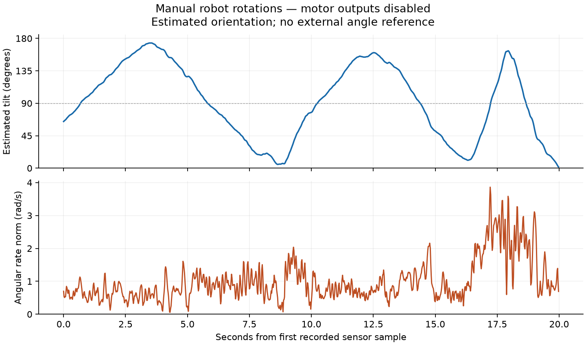

# Motor-disabled policy shadow 0.1

This firmware runs the exported neural actor on the XIAO nRF52840 Sense using its calibrated IMU. **It contains no servo/PWM driver. D8 and D7 are held LOW.** Joint targets and previous actions are virtual bookkeeping; the robot does not respond to them. A successful shadow run establishes arithmetic, observation handling and timing, not physical recovery.

Uploaded and checked on **1 November 2026**. The [initial 500-frame capture](results/2026-11-01/2026-11-01_initial_01.json) has zero I2C errors, 1,199 µs median / 1,208 µs maximum actor inference, and maximum MCU-versus-host action error 2.32e-7. No frames were over 10 ms late; maximum scheduling lateness was 1,376 µs. Flash is 82,320 bytes and static RAM 7,736 bytes. [Commissioning provenance](results/2026-11-01/commissioning.json) records source/image hashes and build settings.

The [2 November manual check](results/2026-11-02/manual_check.json) adds 1,000 frames during approximately three user-performed tilt/return cycles and 250 stationary follow-up frames. Estimated tilt reached 173.6°. There were no I2C errors, saturation, filter resets or frames more than 10 ms late. Actor inference was 1.224 ms median / 1.238 ms maximum during movement; maximum host/MCU action difference was 5.74e-7. The subsequent stationary estimate stayed at 1.49–1.50° tilt. This is a qualitative response/stability check; without an external angle reference, these numbers are not angular accuracy measurements.



Recreate this plot with `.venv-sim/bin/python scripts/plot_shadow_capture.py firmware/policy_shadow/results/2026-11-02/2026-11-02_manual_rotation_01.csv --out build/shadow/manual_rotation.png`.

## Run from the terminal

For programming and these sensor-only checks, disconnect the battery and both complete three-pin servo plugs, then connect USB. The direct-power Rev B harness has no electronic power cutoff.

```sh
python3 scripts/robot.py build-shadow
python3 scripts/robot.py upload-shadow
.tools/arduino/python/bin/python scripts/shadow.py --seconds 10 --label upright --out build/shadow/upright_01.csv
```

The recorder checks the complete firmware banner and ready status, starts a bounded stream, writes CSV plus JSON, compares every action with the host C actor, checks target/action history, then sends stop. Choose a new output name each time. `--label upright` is a human assertion: use it only for an observed upright pose. The saved initial capture is deliberately labeled `initial_pose_unconfirmed`.

Serial commands at 115200 baud: `status`, `sample` (one inference), `stream` (50 Hz for at most 30 seconds), `off`, `!`, `help`. Opening USB does not start inference. New commands stop the previous session. Stale/invalid attitude, serial disconnect and timeout end streaming and clear virtual targets/history. The host limits capture to 25 seconds. `off` stops calculations, not battery power.

To inspect an existing log:

```sh
.tools/arduino/python/bin/python scripts/shadow.py --analyze build/shadow/upright_01.csv
```

Normal `scripts/robot.py upload` still installs servo bench 0.10. `upload-imu` installs the earlier raw sensor diagnostic. Use the explicit `upload-shadow` target for this program.

## Observation and filter contract

The actor takes ten float32 values, in order: base-frame unit DOWN (3), base angular rate divided by 10 rad/s (3), commanded targets divided by 80 degrees (2), and previous actions (2). Inputs/actions are clipped to ±1. Every 20 ms, the two actions increment virtual targets by 0.06 radians, clamped to ±80 degrees. These bounds are the simulator contract, **not measured physical joint limits**.

`MountCalibration.h` applies the provisional sensor-to-CAD rotation and subtracts the stationary gyro bias from the [three-pose commissioning work](../imu_bench/measurements/2026-11-01/commissioning.json). Regenerate it with `python3 scripts/generate_imu_mount.py`; the generator verifies the source-capture hashes. Moving the board invalidates the mounting calibration. Full accelerometer calibration, temperature drift and dynamic gyro scaling remain unmeasured.

`GravityFilter.h` estimates only gravity direction, which is sufficient for this actor; it does not estimate yaw. It propagates DOWN with the gyro using Rodrigues rotations and gently corrects toward negative normalized accelerometer readings on the unit sphere. The 1.5/s correction gain is reduced when acceleration magnitude differs from 1 g or angular rate is high. Initialization requires 20 consistent, approximately stationary samples: gyro norm ≤0.15 rad/s, acceleration within 0.15 g of 1 g, and direction agreement. Keep the base still at startup.

A gyro clip or invalid/gapped timestamp invalidates the filter. An accelerometer clip prevents correction but retains gyro propagation once initialized. This distinction avoids discarding orientation at every impact. A filter reset requires another stationary initialization. `filter_rejects` includes normal startup: the initial 19 not-ready updates are expected. Magnitude gating cannot distinguish all linear acceleration from gravity; this is an estimator heuristic, not a measured dynamic accuracy guarantee.

The onboard sensor runs at 208 Hz, ±8 g, ±2000 degrees/s using the earlier bounded TWIM1 driver. Policy deadlines and sample intervals use an exclusive, polled NRF_TIMER4 counter at 1 MHz. The sketch does not enable DWT or alter the core's coarse `micros()`. TIMER4 ownership must be revisited if a future library also needs it. Build uses `-O2` rather than the core's `-Ofast` to preserve finite-value guards. I2C fault deadlines still use core time; physical bus-fault worst-case latency has not been measured.

`t_us` is the last sensor sample timestamp, not inference start. Sampling at 208 Hz means individual telemetry intervals vary even with a 50 Hz policy schedule. The initial capture averages 20,002 µs between these timestamps (49.995 frames/s); sample age reached 8,312 µs. The inference timer covers the actor only, not I2C, filtering, ADC or USB formatting.

BAT telemetry with the battery disconnected measures the USB charger/BAT node. It is not cell voltage or battery health. The sketch retains the board's approximately 100 mA charging selection; it is not a battery disconnect or over-discharge protection.

## Simulation with the same C++ filter

```sh
.venv-sim/bin/python sim/recovery/evaluate_filter.py --seed 29000 --episodes 30 --out build/shadow/filter_check.json
```

`filter_runtime.py` compiles the actual firmware filter and mounting header for the host. MuJoCo specific-force acceleration and angular rate are sampled at approximately 208 Hz, transformed into sensor axes, given exploratory bias/noise and clipping, then fed through that code. Actor inputs use filtered DOWN and calibrated gyro; truth orientation is used only for scoring. Dynamics, floor friction and initial tilt/azimuth are randomized. Each trial has a 10-second budget and the existing success definition: upright base, nearly centered joints, low angular rate and floor contact held for one second.

| Experiment | Seeds | Recovery | Filter unavailable |
|---|---|---:|---:|
| Initial implementation, development | 19000–19029 | 22/30 | 8/30 |
| Refined startup and separate clipping handling, same development set | 19000–19029 | 28/30 | 1/30 |
| Fresh held-out trials, unchanged refined filter | 29000–29029 | 26/30 | 0/30 |
| Paired diagnostic with exact DOWN; same sensor gyro | 29000–29029 | 30/30 | 0/30 |

The [paired comparison](results/2026-11-01/paired_comparison.json) keeps seeds, initial poses, randomized dynamics, gyro and actor identical, replacing only DOWN supplied to the actor with truth. All four filtered failures recover in that diagnostic. This isolates sensitivity to orientation estimation in these cases. Reproduce it by adding `--truth-down` to the command above, with a new output filename. The diagnostic deliberately supplies truth to the actor and is not a deployable observation pipeline.

All reports, including failed trials and historical header hashes, are preserved in [results](results/2026-11-01). The original initial-filter source is not retained as a runnable checkpoint; its report is historical. These are exploratory tests with assumed sensor noise/bias, exact known mounting, and no sensor analog filtering/FIFO/transport-latency model. They do not replace hardware measurements. Earlier 100/100 results used ideal orientation plus simple observation noise on a different evaluation set; they are not evidence of 100% filtered recovery. No training weights were changed in this stage.

## Next physical checks

1. The guided slow rotation check is recorded. An external video/angle reference is still needed to quantify dynamic orientation accuracy and verify gyro scaling under faster motion.
2. Measure each joint's pulse-to-angle sign, neutral and unobstructed range. The current ±80-degree virtual targets must not be sent directly to the robot.
3. Measure loaded step response, delay, speed and battery behavior, then update the servo model.
4. Train/evaluate with the calibrated observation pipeline and servo model before supervised real recovery.

Run `python3 scripts/robot.py test` for the filter's analytic motion checks and actual-sketch tests with fake USB/I2C/time, alongside the existing firmware tests. Host tests cover no automatic inference/PWM, action history, stale/timeout/disconnect behavior, slow USB and clock rollover. Native timing and physical sensor data are separate evidence recorded above.
