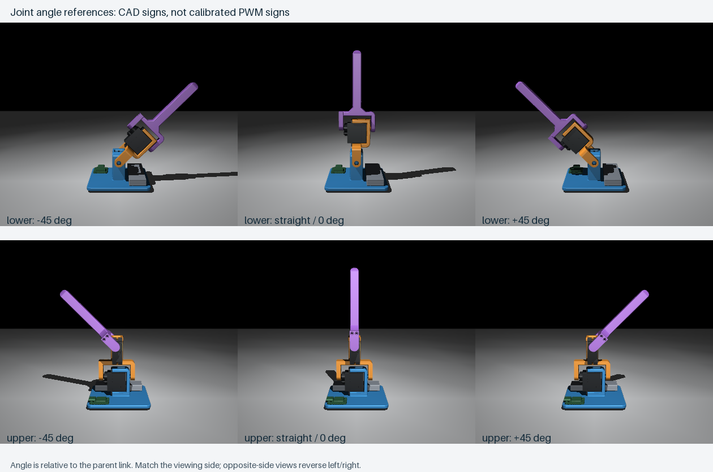

# Visual servo calibration 0.1

This is a supervised pulse-to-angle measurement program for the assembled Rev B robot. It contains **no learned controller**. Both signals start LOW. Only an explicit `lower` or `upper` command starts PWM, at nominal **1500 µs**. The other joint receives no PWM and must be supported. The first pulse can move an unknown starting shaft position; the subsequent slew limiter cannot smooth that initial acquisition without position feedback.

The user chose easy visual poses rather than a precision angle gauge: **straight = 0°, then approximately ±45°, and ±90° if physically clear and reachable**. These observations give a first approximate mapping; they do not establish precision angular accuracy, dynamic tracking, backlash or loaded torque.



These signs are the CAD right-hand convention. Match the viewing side and the board/battery placement; viewing from the opposite side reverses left/right. The upper angle is relative to the middle link, not the table. Physical PWM signs stay unconfirmed until a movement is compared with the reference. The image is a kinematic pose illustration, not a continuous collision-clearance certificate. Regenerate with `.venv-sim/bin/mjpython sim/render_calibration_reference.py`.

## Terminal / VS Code

For uploading, use USB with battery and both complete three-pin servo plugs disconnected:

```sh
python3 scripts/robot.py build-calibration
python3 scripts/robot.py upload-calibration
```

To reconnect for supervised motion: unplug USB, connect servo plugs and battery, then reconnect USB. Support both links, including the joint without PWM, with clearance around the arm.

```sh
.tools/arduino/python/bin/python scripts/calibrate_servos.py --out build/calibration/session_01.json
```

The recorder verifies the firmware and stopped state. **Connecting does not start a servo.** Use a new output filename for every session. CSV contains timestamp, selected joint, target pulse, applied pulse and BAT-node estimate. JSON stores the visually observed angles plus notes and commands; a text file preserves raw serial responses.

| Terminal command | Effect |
|---|---|
| `lower` / `upper` | Start only that joint at nominal 1500 µs; this is not a measured mechanical zero |
| `+` / `-` | Nudge its target by 25 µs; these are pulse increments, not angle increments |
| `pulse N` | Request an absolute pulse, no more than 50 µs from the previous target |
| `mark 0 straight` | Record the applied pulse as visually straight, once commanded PWM is settled |
| `mark 45 positive CAD direction` | Record a visually observed +45° pose; only use the CAD wording after comparing the reference |
| `mark -45 negative CAD direction` | Record the opposite visually observed pose |
| `status` | Read active joint, pulse window and battery estimate; does not start or stop PWM |
| `off` | Stop PWM; direct servo power remains live |
| `window MIN MAX` | Change the command envelope while off; starts at 1000–2000 µs, absolute allowed envelope 500–2500 µs |
| `quit` / Ctrl+C | Request PWM stop and close the recorder |

Find straight first, saving its actual pulse even if different from 1500 µs. Then nudge toward an easy 45° bend, mark it, and return through straight to the other side. Take repeat observations approached from both directions to expose noticeable backlash/deadband. Start a new selected-joint session if the absolute timeout expires. Do not paste a whole motion sequence: observe the joint after each nudge.

The initial 1000–2000 µs **command envelope is not a measured safe range**. Previously observed dance pulses were 1100–1900 µs; clearance outside that interval remains unverified. Widen gradually only while observing the actual mechanism. A wider `window` command enables wider commands but proves nothing about physical travel. The firmware never automatically sweeps to either endpoint or labels it as a 90° pose. The simulator's ±80° range remains provisional and is not changed by these measurements.

`mark` is accepted only with fresh active telemetry and at least 200 ms of unchanged applied PWM equal to target. That is a settled **pulse command**, not encoder confirmation of a settled shaft. The user must observe the angle and whether motion/buzzing has stopped. JSON retains provisional viewing signs and `CAD_sign_confirmed: false` until a later reviewed mapping is created; nothing writes into the deployed policy or simulator automatically.

## Firmware behavior and evidence

The existing `FineServo.h` adapter supplies 1 µs pulse resolution and a 50 Hz frame. Subsequent target changes are limited to 50 µs per command, and the applied pulse changes by at most 1 µs per 10 ms (at most 100 µs/s), with no large catch-up after a delayed loop. Host `+`/`-` uses 25 µs steps. There is one active joint at a time.

The recorder sends a heartbeat each second. Firmware stops after 5 seconds without it, after 120 seconds of a selected-joint session even with heartbeats, on USB serial disconnect, malformed input, `off` or `!`. Initial battery estimate must be 3.7–4.4 V. During motion, sampling every 100 ms stops after two readings below 3.6 V, one below 3.4 V, or one above 4.4 V. These are the existing bench guards, using the uncalibrated ADC and approximately 100 mA charging selection. USB can alter the BAT reading and does not prove net charging. No current measurement or physical low-voltage cutoff exists. Disconnect battery and USB after supervised use; stopping PWM cannot remove idle drain.

Built and uploaded on **2 November 2026**: **48,316 bytes flash / 7,680 bytes static RAM**, `-O2`, installed Seeed nRF52 1.1.13 / Arm GNU 13.2.Rel1. Uploader returned `Device programmed.`. The recorder verified the complete 0.1 banner and `ACTIVE_JOINT: -1` without issuing a movement. [Provenance](results/2026-11-02/deployment.json) records hashes. The subsequent [visual mapping](results/2026-11-02/visual_mapping.json) records six user-confirmed poses: three per joint. The earlier successful dance alone was not an angle calibration.

Run `python3 scripts/robot.py test` for the actual-sketch test with fake GPIO/PWM/battery/USB/time, along with existing firmware tests. Calibration coverage includes single-joint selection, gradual steps, delayed-loop behavior, command/window bounds, malformed input, battery refusal/stops, failed PWM attachment, emergency/disconnect/timeouts and clock rollover. The existing PWM adapter test separately checks the actual timer adapter. These host tests do not measure physical shaft response.

Other firmware remains available: `upload-shadow` restores the motor-disabled learned-policy/IMU program; ordinary `upload` installs servo bench 0.10. None of these targets automatically enables learned physical recovery.


## Measured visual references — 2 November 2026

| Joint | +45° CAD angle | Straight / 0° | −45° CAD angle |
|---|---:|---:|---:|
| Lower | 1100 µs, toward XIAO | 1500 µs | 1900 µs, toward battery |
| Upper | 1100 µs, away from XIAO edge | 1500 µs | 1900 µs, toward XIAO edge |

The user confirmed all six poses visually. The lower CAD axis is +X: positive rotation tips the upright link toward −Y (XIAO side), while the battery is at +Y. The upper axis is +Y: positive rotation tips toward +X, away from the XIAO edge at −X. Thus **increasing pulse means decreasing CAD angle for both joints**. CAD axes and trained-policy angle signs remain unchanged; eventual hardware conversion must apply this negative slope.

The three approximate points per joint give `pulse_us = 1500 - (400/45) * angle_deg`, or about **−509.3 µs/radian**. Numerical interpolation is not angular precision. Use the [offline converter](../../scripts/servo_mapping.py) without opening serial:

```sh
python3 scripts/servo_mapping.py lower 45
python3 scripts/servo_mapping.py upper -22.5
python3 scripts/test_servo_mapping.py
```

The converter only interpolates between observed poses, requires a reviewed direction sign and rejects outside-range/non-finite requests. It sends **no motor commands** and does not update the deployed firmware or simulation. In particular, it refuses ±80° and ±90° rather than extrapolating an unmeasured range. Physical end stops, simultaneous joint combinations, loaded speed/lag and voltage dependence remain unmeasured. The intentionally slow command ramps in this session do not identify intrinsic servo speed. Future training must account for the uncertainty of these visual estimates.

The [raw JSON](results/2026-11-02/visual_session.json), [CSV](results/2026-11-02/visual_session.csv) and [serial transcript](results/2026-11-02/visual_session.txt) are preserved with SHA-256 hashes in the reviewed mapping. The recorder's raw provisional-sign flags remain untouched; the separate reviewed mapping records confirmation from the user's direction observations. Mapping tests check each point against its exact applied-pulse telemetry row and original observation, raw hashes, interpolation, sign consistency, and rejection of extrapolation/non-finite/unreviewed inputs.

This session also includes the user's requested small cycling exercise. Battery ADC estimates across the active telemetry were **4.124–4.156 V with USB connected**. One absolute 120-second timeout stopped the lower joint during a return; the next target was rejected because PWM was off. An explicit selection restarted at 1500 µs and calibration continued. This is not evidence of a mechanical fault. Both joints' last applied targets were 1500 µs, then OFF was acknowledged and the host recorder closed. Direct servo power is not switched off by PWM stop; the user was asked to disconnect battery and USB afterward.
