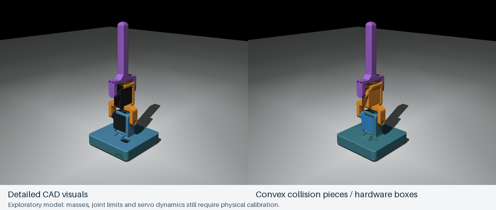

# Fit-approved enclosure model

**CAD revision note:** the [C3 printable cup](../../cad/electronics_pod/README.md) now has a tighter USB opening and shifted battery. This saved model/results remain C2. Its exact CAD inputs are frozen in [source/fit_approved_c2](source/fit_approved_c2); the model builder and joint viewer use that snapshot. C3 has not silently replaced training geometry, masses or checkpoints.

Updated 3 November 2026. The user confirms the Rev C2 cup/lid fit and the XIAO sits in the modeled orientation. Initial retraining experiments are complete. **The candidate is not yet reliable enough for hardware promotion.** This model uses the approved printed geometry, relocated battery/XIAO and one Pololu 2810. The original `sim/robot.xml` and deployed actor remain unchanged for comparison. No hardware commands or firmware uploads are part of this model/training work.



## Move the joints

[Open the self-contained joint-slider review](joints.html). When served locally it supports lower/upper angle sliders and drag-to-orbit. It uses the same neutral component placements and serial hinge axes as the physics model. The browser view is kinematic: it does not enforce contact or run an actor.

For the actual MuJoCo model, from the repository root:

```sh
.venv-cad/bin/mjpython sim/view.py --model sim/enclosure/robot.xml --manual
```

Left/right changes the lower target by 5°, down/up changes the upper target, Enter centers both. The finite-torque PD controller moves the joints; these are targets rather than exact angle constraints. Drag to orbit, scroll to zoom, double-click a body then Control + right-drag to exert force. The review holds requested angles; it is not learned recovery. [Joint-motion animation](joint_motion.gif).

## Geometry and mass

The cup occupies CAD Z=-12…0 mm; the 2 mm lid and retained lower-servo frame are above it. Both hinge axes stay at the confirmed CAD origins `(0,0,24.4)` mm along X and `(-2.35,0,61.4)` mm along Y. The default base pose puts the new bottom 1 mm above the floor. Overall nominal ground-to-tip height is 163 mm.

The attached `Untitled.gcode.3mf` contains the correctly named lid and cup. Names, plate image and 35/12.8 mm toolpath heights establish the mapping. [Raw parsed accounting](slicer_masses.json) separates model material from support/interface. No printer commands are executed.

| Contribution | Assigned mass |
|---|---:|
| New cup | 15.574 g |
| New lid with servo frame | 13.552 g |
| Removed support/interface | 0.821 g, excluded |
| Complete base body, including fixed electronics and lower servo | 61.725 g |
| Middle body | 19.197 g |
| Upper body | 7.065 g |
| Total model | **87.987 g** |

This job uses PLA Matte at 1.32 g/cm³, 0.2 mm layers, two walls, five top/three bottom layers and **15% grid infill**. Slicer estimates are not measured weights. The 30.05 g plate header includes supports and about 0.104 g unassigned material; do not assign it all to the robot. The old arm parts retain their original slicer masses.

New part COM/inertia come from exact STEP volume moments scaled to their sliced masses. All components are combined with the parallel-axis theorem. The aggregate upright COM is approximately `(-1.797,1.746,20.119)` mm in CAD axes, or 32.119 mm above the new bottom. Shell/infill distribution is approximated as uniform CAD density.

The Pololu is assigned its manufacturer's nominal **0.6 g** ([Pololu 2810](https://www.pololu.com/product/2810)). The existing battery 14.5 g, servo 13 g each, XIAO 4 g and 0.5 g small-hardware allowance per rigid body remain the previously documented estimates; the header-free board has not been weighed. Separate wire/PSA mass is omitted per the earlier wiring-mass decision. [Full component and tensor report](model_report.json).

The IMU site moves with the board to approximately `(-22.959,-15.500,-7.170)` mm. Its location is the board-envelope COM proxy, not a measured chip center. The board orientation is unchanged and user-confirmed, so the measured sensor-to-base rotation remains the current starting calibration. A still-base gravity check follows wiring before hardware deployment.

## Contacts

The cup uses a convex closed exterior that preserves the 5 mm side corner radii and 1 mm bottom radius. Ports, tiny locating tabs and internal cavities are omitted from collision geometry; fixed electronics cannot move inside the closed assembly. Detailed visuals retain them. The lid/frame and arm use separate convex collision pieces.

**Adjacent-body contacts are active.** No whole-body pair is excluded. To prevent fictitious contact at the fitted shafts/bearings, only convex pieces whose entire vertex set lies inside a 6 mm hinge-axis cylinder are masked against that adjacent body. Those pieces still contact the floor and nonadjacent bodies. The [contact policy](contact_policy.json) records all 50 sleeve pieces and the bit classes. This is an explicit approximation of fitted bearing surfaces, not a claim of exact bearing clearance.

Checks cover all body inertias, IMU translation, bottom height, zero false neutral contacts, a compound-angle grid, actual nonmating contact in a deliberately out-of-range fold, ten placed-fall trials and 1,000 random-action steps without numerical warnings. The 81 grid poses across ±80° have no nonmating penetration exceeding 0.2 mm. This sampled result does not prove all continuous swept clearances. [Validation record](validation.json).

## Sensor-aware training

The new experiment uses the same 10-input / two-action / 50 Hz contract and finite-speed, torque-limited servo dynamics, with the actual portable firmware gravity filter applied to noisy simulated accelerometer/gyro readings at the relocated IMU site. Thirty noisy held-still IMU samples initialize the filter before release, then the robot settles for 0.8 s. Exact gravity is not assigned to the actor. An invalid filter ends control with a fault, matching the firmware's stop behavior approximately at physics-step resolution.

The old actor's initial comparison is **8/20** recoveries on seeds 23000–23019 with this pipeline. [Baseline details](baseline_old_actor.json). The earlier [fixed-settle-only diagnostic](baseline_fixed_settle_only.json) had 6/20, including six filter-initialization refusals; it is retained as a diagnostic and is not the paired training comparison.

Recovery search first finds feasible open-loop demonstrations on the revised contact model. Filtered demonstration collection keeps only successful, collision-audited attempts, then behavior cloning initializes the 10→64→64→2 actor. PPO refinement and checkpoints are evaluated against that starting actor; a separate fine-tuning run starts from the deployed actor. The best development result is retained, even if it precedes PPO. Held-out tests remain separate from model selection. No candidate replaces the uploaded actor automatically.

## Initial results

All three experiments use the revised geometry and firmware filter. Success still requires base tilt below 10°, both joints within 0.18 rad of neutral, low angular rate, and base-floor contact for a continuous second. Recovery motions searched successfully in 9/9 standard fallen requests. The dataset contains **52 accepted trajectories from 80 attempts, 10,249 observation/action pairs**.

| Experiment | PPO transitions actually run | Selected added PPO steps | Nominal | Development | Held-out scripted |
|---|---:|---:|---:|---:|---:|
| New demonstrations → BC, raw rewards | 67,584 | 16,896 | 5/10 | 4/10 | 8/30 |
| Existing deployed actor → PPO, completion bonus 300 | 67,584 | 16,896 | 3/10 | 2/10 | 9/30 |
| Actor from first run → fresh critic, normalized training rewards, completion bonus 300 | 67,584 | **67,584** | **7/10** | **9/10** | **19/30** |

Total PPO computation was **202,752 transitions**, plus 3,000 behavior-cloning minibatch updates in the first run. The selected actor inherits 16,896 PPO steps from that first run and adds 67,584, for 84,480 steps along its selected ancestry. Training-step counts describe additional work per run, not independent episodes. Checkpoint selection uses nominal + development successes only; held-out results never choose the checkpoint.

On **30 fresh random-pose trials with identical seeds/parameters**, the selected candidate completes recovery **18/30**, compared with **8/30** for the old actor on the new geometry. [Candidate trials](results/randomized_evaluation.json) and [paired old-actor trials](results/old_actor_paired.json). Requested tilt is uniform 0…π and horizontal tilt-axis azimuth uniform 0…2π, followed by settling with neutral joints; this is not uniform SO(3) or arbitrary initial joint configurations.

This is an improvement, but failed directions and reliable return to a quiet neutral posture remain. No new weights are uploaded or included by the existing firmware. The user's behavior goal is persistent recovery with room for expressive, imperfect attempts; see [recovery behavior and the next reward-design experiment](../../docs/RECOVERY_BEHAVIOR.md).

### Longer attempts: does it recover if we wait?

The same 20 nominal/development cases were continued for up to **60 seconds** with unchanged deterministic control, no automatic resets, no scripted kicks and no added exploration. Historical episode timeout/success flags do not stop this diagnostic; an actual filter/numerical/invalid-state fault still would. Timing starts after initialization/settling, as in the original tests. The test stops on strict success or at the horizon, so it does not establish subsequent standing endurance.

| Goal | By 10 s | By 30 s | By 60 s |
|---|---:|---:|---:|
| Base stable upright; joints unrestricted | 16/20 | 16/20 | 16/20 |
| Historical strict straight-joint goal | 16/20 | 16/20 | 16/20 |

The four unresolved cases are nominal side_000, side_045, side_090 and development side_090. They reached neither one-second goal even with more time; there were no filter/numerical faults. This distinguishes a behavioral limitation from a short evaluation window or a straight-joint scoring penalty. A finite horizon cannot establish that a robot will never recover. [Per-case timing and motion diagnostics](results/persistence_evaluation.json).

For the next experiment, train through failed attempts and post-recovery disturbances, cover trapped states/varied initial joint poses, and make stable base recovery primary with a soft neutral-arm preference. Preserve the old strict score as a regression measure. Continuing inference is already supported; making that continuation effective needs further learning. No reward or weights were changed by this longer diagnostic.

```sh
.venv-sim/bin/python sim/enclosure/evaluate_persistence.py --seconds 60 --workers 3
```

The selected 4,994-parameter actor exports to portable C with **4.17e-7 maximum output error on 2,000 inputs**. A 700-frame continuous-control test, including a small applied force, passes without numerical warnings and finishes stable. Those are software checks, not physical recovery validation. [QA record](qa.json).

Open the experimental recovery playground (same new geometry and filter):

```sh
.venv-sim/bin/mjpython sim/enclosure/play.py
```

Select a body with double-click, then Control + right-drag to pull; Enter resets the complete simulation/controller, Space pauses. Large disturbances or failed starts can exceed this candidate. VS Code has tasks for both manual joint inspection and the experimental recovery playground.

[Recorded candidate animation](results/recovery_candidate.gif) deliberately includes a side-start that does not complete the strict success dwell, alongside a successful inverted request. Inverted requests may tip sideways during the initial settling; traces preserve the actual controlled pose. This is not a montage of successes only.

## Reproduce

```sh
.venv-cad/bin/python sim/enclosure/parse_slicer.py
.venv-cad/bin/python sim/enclosure/build_model.py
.venv-cad/bin/python sim/enclosure/check_model.py
.venv-cad/bin/python cad/onshape_import/build_review.py --enclosure
.venv-cad/bin/python sim/onshape/render_preview.py --model sim/enclosure/robot.xml --out sim/enclosure

# The path is inherited by spawned workers. Defaults still use the old model.
export ROBOT_MODEL_PATH="$PWD/sim/enclosure/robot.xml"
.venv-sim/bin/python sim/recovery/search.py \
  --cases side_000 side_045 side_090 side_135 side_180 side_225 side_270 side_315 inverted \
  --population 32 --iterations 5 --workers 3 --out runs/enclosure_c2_search_seed17
.venv-sim/bin/python sim/recovery/audit.py runs/enclosure_c2_search_seed17/report.json
.venv-sim/bin/python sim/recovery/collect.py runs/enclosure_c2_search_seed17/report.json \
  --filtered --repeats 8 --out runs/enclosure_c2_demos_seed17
.venv-sim/bin/python sim/recovery/learn.py runs/enclosure_c2_demos_seed17/dataset.npz \
  --filtered --bc-updates 3000 --ppo-steps 65536 --envs 3 --out runs/enclosure_c2_policy_seed17

# Separate fine-tuning comparison, with a completion bonus above the
# 2.5/(1-gamma)=250 upper bound on discounted continuing reward at gamma=0.99.
# This avoids rewarding delayed completion; success criteria are unchanged.
ROBOT_SUCCESS_BONUS=300 .venv-sim/bin/python sim/recovery/learn.py \
  runs/enclosure_c2_demos_seed17/dataset.npz --filtered \
  --warm-start sim/recovery/results/policy_simulation_only.zip \
  --ppo-steps 65536 --envs 3 --out runs/enclosure_c2_warm_seed17

# Selected comparison: transfer the first run's best actor, reset the critic,
# normalize rewards only (actor observations and MCU contract stay unchanged).
ROBOT_SUCCESS_BONUS=300 .venv-sim/bin/python sim/recovery/learn.py \
  runs/enclosure_c2_demos_seed17/dataset.npz --filtered \
  --warm-start runs/enclosure_c2_policy_seed17/best.zip --actor-only \
  --normalize-rewards --initial-log-std -2 --ppo-steps 65536 --envs 3 \
  --out runs/enclosure_c2_normalized_seed17
unset ROBOT_MODEL_PATH
```

Each run records the model hash. PPO saves named checkpoints at each evaluation stage, roughly every 16,384 requested transitions, as well as `bc.zip`, `best.zip` and `latest.zip`. PPO rounds to full rollouts; read actual transition counts in the report. The complete comparison is preserved under [results](results/summary.json), including all 15 named checkpoint ZIPs and return-normalization snapshots. Development files remain under `runs/`. Exact PPO episode-completion counts were not logged in these initial runs; transition counts below are authoritative.

Hardware deployment remains separate: finish the [master-switch wiring](../../electrical/README.md), upload charge-mode firmware 0.3 and verify through-switch charging/current, then check stationary IMU orientation and run supervised recovery trials. The new CAD and training scripts need no additional user measurements to begin; optional whole-robot weighing and loaded servo measurements can improve subsequent calibration.
