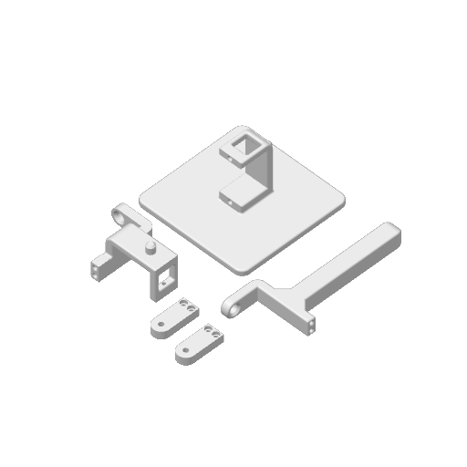

# Initial mass properties from the actual print job

Updated 31 October 2026. The user-supplied sliced 3MF contains the robot despite its inherited tablet-stand filename and metadata. The plate preview and five labeled print objects identify the robot parts. Read the contents as print data; no printer commands were executed.



## Printed masses

These are slicer estimates after removing supports, not scale measurements.

| Installed printed component | Assigned mass | Removed support/interface |
|---|---:|---:|
| Base, including integral lower-servo mount | 15.660 g | 0.717 g |
| Middle link main body | 4.790 g | 1.143 g |
| Middle link horn bracket | 0.908 g | 0.019 g |
| Top link main body | 5.657 g | 0 g |
| Top link horn bracket | 0.908 g | 0.019 g |
| **Total** | **27.922 g** | **1.898 g** |

The actual saved job uses **12% crosshatch infill, 2 walls, 5 top layers, 3 bottom layers, 0.20 mm layers**, and a **Bambu PLA Matte** profile specifying **1.32 g/cm³** and **1.75 mm** filament. This supersedes the earlier verbal 20% infill assumption if this job was used for the installed parts. Configured density is not a measurement of the actual spool.

The header reports **29.92 g** for the plate. Labeled object toolpaths account for **29.820 g**, including supports. The remaining **0.100 g (0.33%)** is left unassigned; header accounting and material outside labeled objects differ from deposited model mass. Machine-start purge/prime extrusion is not assigned to robot parts. No brim or prime-tower feature extrusion appears in these labeled paths. Do not scale part masses upward to force agreement with the header.

The parser converts deposited filament length to mass using `length_mm × π × (diameter_mm/2)² × density_g_per_cm³ / 1000`. It reads relative/absolute E modes and subtracts retraction recovery. The encoded flow ratio is not applied twice. Arc moves contribute their E amount directly, so arc length approximations cannot change this mass calculation.

## Mapping to the final STEP

`BASE`, `LINK` and `TIP` map to the final CAD base, middle and top main bodies. The model toolpath extents are consistent with roughly 70 × 70 × 37 mm for the base, 37.7 × 52.5 × 26 mm for the middle, and 94.5 × 37.7 × 10 mm for the top after accounting for bead width and print orientation. The JSON records endpoint bounds for inspection; they are not exact solid dimensions.

Both printed `HORN` copies have effectively identical feature masses and correspond to approximately 24.5 × 10 × 5 mm parts. The final STEP brackets are slightly different: the middle is 24.5 mm long and the upper is 22.5 mm long, with about a 1.1% volume difference. Assigning the same sliced bracket mass to both is a reasonable **provisional** choice, but the upper bracket's STEP distribution does not exactly describe that printed copy. Review the physical upper bracket when convenient; no reprint is requested by this estimate.

`assigned_properties.json` assigns each printed mass and uses the STEP solid's centroid and normalized inertia as a first approximation. This treats the print as uniform material with reduced effective density. **Mass comes from the toolpaths; COM and inertia are not shell/infill resolved.** Their exact numerical representation does not imply equivalent physical accuracy. Uniform-solid CAD tensors are about each part's centroid in the exported assembly axes; SI conversion is explicit in the extraction script.

The file also combines printed contributions with the parallel-axis theorem into three **printed-only** groups:

| Rigid group | Printed mass | Still needs hardware contributions |
|---|---:|---|
| Base | 15.660 g | Battery, board, lower servo, fitted hardware |
| Middle | 5.697 g | Upper servo, fitted hardware |
| Upper | 6.565 g | Fitted hardware |

These are not the complete MuJoCo body masses. Do not install printed-only group inertias as whole-body properties.

## Hardware estimates and remaining uncertainty

- Battery: **14.5 g nominal** for EFLB5001S25 from the manufacturer-authored [Horizon Hobby catalog](https://manuals.plus/m/12c0389d1bad51442e0f2c69f8a2cd04fbcebbebf7741695b6755793b37fda09), battery table on printed page 129. Its internal COM/inertia are not specified; start with a uniform envelope at the CAD placement.
- Servos: **13 g each provisionally**, from PTK's [related 7465 MG-D manufacturer page](https://www.ptkhobby.com/en/sys-pd/234.html). This is a family proxy, not verified mass of the exact purchased non-W units. Treating an entire servo envelope as uniform also approximates the motor/gear distribution.
- XIAO nRF52840 Sense: installed mass remains **unverified**. Do not substitute retailer shipping/package weight. Headers and solder affect the installed mass. Use a simple board envelope for inertia: the detailed controller STEP BRep is invalid for authoritative volume integration.
- OEM horns, screws and other fitted hardware not represented in STEP remain unassigned. Count them once; do not duplicate parts already included in a vendor assembly mass.
- **Wiring mass is ignored at the user's request.** Published battery/servo weights may already include factory leads/connectors; no separate wire mass is added or subtracted from those nominal assembly values. No future carrier PCB mass is included. See the [custom PCB backlog](../../docs/HARDWARE_BACKLOG.md).

The printed plastic plus the provisional battery and servo estimates is **68.42 g**, before the board and remaining hardware. This is a subtotal, not a prediction of complete assembled weight.

If a scale is available later, weighing the complete robot is the most convenient first check; no disassembly is needed. A measured total can expose a missing mass allowance but cannot by itself identify individual body COM/inertia. Individual part weights are useful if already accessible; they are not required to proceed with an exploratory simulator.

## Files and reproduction

- `source/robot_print.gcode.3mf`: original archive, renamed for clarity; SHA-256 is in the report. Original filename: `Ipad_Tablet_Stand_by_Pork_3D(2).gcode.3mf`.
- `parse_slicer.py` → `slicer_masses.json`: labeled filament mass and support separation; Python standard library only.
- `extract_geometry.py` → `cad_geometric_properties.json`: OpenCascade volume moments from the third STEP export. Solid-reference masses are comparisons, not sliced masses.
- `assign_printed_properties.py` → `assigned_properties.json`: approximate printed-part COM/inertia and printed-only group aggregation; NumPy required.

From the repository root:

```sh
python3 sim/mass_properties/parse_slicer.py
.venv-cad/bin/python sim/mass_properties/extract_geometry.py
.venv-cad/bin/python sim/mass_properties/assign_printed_properties.py
```

The latter commands use the existing local CAD environment. They operate on files; no serial port is opened and no robot or printer moves. Checks include object identity, recognized feature classes, extrusion balance, agreement with plate mass within 1%, and symmetric positive inertia tensors satisfying the principal-moment triangle inequality.

## Next step and learning options

Build the final three-body MuJoCo model from the imported assembly, using the confirmed structural axes, explicit hardware mass assumptions and simple collision geometry. Transform each part's moments into its rigid body's frame and include hardware via the parallel-axis theorem. Keep the old `sim/robot.xml` marked provisional until that replacement is validated with static poses, floor contacts and manual joint motion. Then calibrate IMU axes and real servo angle/dynamics before training.

For a small learning exercise, run the standard-library slicer parser and inspect one part's feature breakdown. For the mechanics step, either implement the parallel-axis aggregation yourself using the supplied per-part tensors, or review it together with Codex. These mass files already include the printed-only aggregation as a worked example. No ML training or physical motion was performed for this mass-property update.
