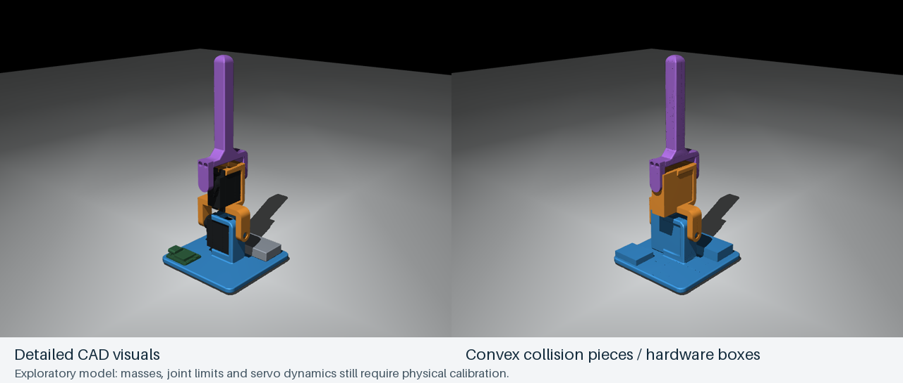

**New enclosure variant:** the fit-approved Rev C2 robot is now modeled separately in [sim/enclosure](../enclosure/README.md). This page and `sim/robot.xml` preserve the pre-enclosure model used by the currently deployed actor.

# Final Onshape assembly in MuJoCo

The current `sim/robot.xml` is generated from the user's third STEP export and slicer-derived printed masses. It replaces the earlier primitive-only robot. This is an exploratory physics model, with hardware and actuator assumptions still awaiting calibration; it is not a trained recovery controller.



[Watch the simulated two-joint motion check](joint_motion.gif). This animation exercises the joints with a simple sinusoidal controller; it does not demonstrate learned recovery.

## What is modeled

| Body | Attached components | Mass used |
|---|---|---:|
| Base, free to move in world | Printed base, lower servo housing, battery, controller, small-hardware allowance | 47.660 g |
| Middle | Middle main body and horn bracket, upper servo housing, small-hardware allowance | 19.197 g |
| Upper | Top main body and horn bracket, small-hardware allowance | 7.065 g |
| **Total** | Includes the assumptions below | **73.922 g** |

The nine original CAD instances keep their exported placements. The lower pivot is X-directed through CAD `(0, 0, 24.4)` mm; the upper pivot is Y-directed through `(-2.35, 0, 61.4)` mm. The latter is the user-confirmed structural axis, including the documented 0.57 mm servo-model offset. Joint-body frames are translated from the CAD frame without rotating their axes; all mesh units are converted to meters.

The base is 70 × 70 mm and the CAD spans 153 mm from underside to tip. The free base's default origin is 3 mm above the floor, leaving 1 mm initial clearance beneath the CAD's Z=-2 mm underside.

Each body's mass, COM and full inertia tensor come from component aggregation with the parallel-axis theorem. Printed masses come from the actual toolpaths; their spatial distribution is approximated by uniform CAD solids. Hardware uses uniform CAD distribution, except the invalid detailed board solid, which uses its bounding box. See [body_properties.json](body_properties.json) for all contributions and CAD-frame tensors; the XML expresses each aggregate COM relative to its own joint/body frame.

## Explicit assumptions

Edit [assumptions.json](assumptions.json), then run the builder and checks below.

- Battery is nominally 14.5 g; each servo is provisionally 13 g from the related MG-D family. Source qualifications are in the [mass report](../mass_properties/README.md).
- The board is an **assumed 4 g**, carried over from the earlier model, not a verified manufacturer weight. Small hardware has an **assumed 0.5 g allowance per body**, distributed near the corresponding pivot. Neither is a physical measurement.
- No separate wiring mass or future carrier PCB is added. Vendor battery/servo assembly masses may already include factory leads.
- The identical sliced horn brackets are both assigned about 0.908 g, although the upper STEP bracket is slightly shorter.
- Joint travel is provisionally ±80°, with mathematical positive directions following the right-hand rule. A later [visual static calibration](../../firmware/servo_calibration/results/2026-11-02/visual_mapping.json) identifies nominal 1500 µs zero and negative pulse-to-CAD-angle signs on both joints, with approximate ±45° references at 1100/1900 µs. Full travel and compound clearance remain unmeasured; do not extrapolate the visual map to the simulated ±80° limits.
- The motors retain exploratory torque/speed/control parameters. A 0.07 N·m torque limit is not a measurement of the delivered servo at battery voltage.
- The IMU site is at the board envelope center with axes aligned to the base. The physical chip location remains approximate. A provisional measured sensor-to-base transform and gravity filter are now tested in [policy shadow](../../firmware/policy_shadow/README.md). The default environment still uses truth plus simple noise; the filtered evaluator uses the same firmware C++ estimator and simulated specific force.

## Contacts and numerical checks

Detailed visual meshes do not collide. The five printed components use **294 separate convex collision meshes**, generated with [CoACD](https://github.com/SarahWeiii/CoACD); the two servos add 43 convex pieces, for **337 collision meshes** total. Battery and board use CAD bounding boxes. Servo boxes were replaced because their envelopes falsely overlapped the horn brackets around the output shafts. Separate assets preserve the large concavities in the printed frames. A single mesh asset would be convexified by MuJoCo and fill those spaces. See the [MuJoCo 3.2.6 mesh reference](https://mujoco.readthedocs.io/en/3.2.6/XMLreference.html#asset-mesh).

Before decomposition, duplicated seam vertices are welded and degenerate triangles are removed. Four degenerate triangles on the top link had caused automatic remeshing to thicken it; the repaired closed mesh now bypasses that remeshing step. [manifest.json](manifest.json) records parameters, source hashes and per-part quality data. Sum-of-hull volumes differs from each original printed mesh by about 0–1.9%; this is a sanity check, not a proof of spatial coverage or a bound on all surface error. The CoACD concavity threshold is 0.6 mm in real-metric mode. Small screw holes/fillets are approximate.

Floor contacts and base-to-upper self-contact are enabled. **Contacts between adjacent bodies are excluded**, so fitted pivot/housing surfaces do not introduce artificial forces. This also means adjacent links can pass through each other at unvalidated angles: full-range feasibility still requires actual travel limits or a selective contact scheme for those surfaces. Do not use the current ±80° limits as evidence that the hardware clears those poses. This is a material limit on recovery-policy fidelity.

Physics runs at **1 ms**, with policy updates every **20 ms**. The contact time constant is 2 ms. [contact_resolution.json](contact_resolution.json) records an eight-side placed-fall comparison: 2 ms/4 ms stepping/contact settings had a worst penetration of about 1.97 mm; 1 ms/2 ms reduced it to 0.86 mm, and 0.5 ms/2 ms to 0.66 mm. These are numerical checks, not a measured floor compliance model.

Current [model checks](validation.json) cover compile, visual placement, reconstructed inertia, serial hinge transforms, upright stability, and 20 two-second contact trials: upright, eight side/diagonal orientations and inverted, both gently placed and as drop stress tests. There are 40,000 physics steps and no MuJoCo warnings. Worst transient penetration is about 0.86 mm for placed trials and 2.45 mm for the deliberately higher drops. The latter is a stress-test artifact that remains relevant when interpreting impact loads. Successful contact integration is not successful self-righting.

[Environment checks](environment_validation.json) pass Gymnasium's checker and 1,500 random-action steps each with and without parameter randomization. Resets now use the robot's collision support points to place the neutral assembly 2 mm above the floor at the requested orientation, then settle it. They no longer start every orientation at a fixed 180 mm base height. The policy observation/action dimensions remain 10/2; servo dynamics still permit tracking error and are not ideal angle constraints.

These model checks do not train a policy or send physical robot commands. Subsequent [recovery experiments](../recovery/README.md) now include trajectory search, demonstration training, PPO comparisons, held-out evaluation and C-export parity for the selected simulation-only actor. Historical pre-Onshape checks remain in [archive](../archive/software_validation_before_onshape.json).

## Run and inspect

The existing `.venv-cad` environment has the required packages. From the repository root:

```sh
# Open the 3D simulation on macOS. Drag to orbit; close the window to stop.
.venv-cad/bin/mjpython sim/view.py
.venv-cad/bin/mjpython sim/view.py --wiggle
.venv-cad/bin/mjpython sim/view.py --collisions
.venv-cad/bin/mjpython sim/view.py --tilt 90 --azimuth 45

# Regenerate after changing assumptions; these checks send no serial commands.
.venv-cad/bin/python sim/onshape/build_model.py
.venv-cad/bin/python sim/onshape/check_model.py
.venv-cad/bin/python sim/onshape/check_environment.py
```

For a fresh environment, create a Python 3.12 virtual environment and install `sim/onshape/requirements-model.txt`. That file is sufficient for model generation, viewing and Gymnasium checks; the training stack has separate [requirements](../requirements.txt).

Regenerate collision assets only after a CAD import changes:

```sh
.venv-cad/bin/python sim/onshape/prepare_assets.py
.venv-cad/bin/python sim/onshape/build_model.py
```

Generation takes roughly a minute on this Mac. The seed and package version are recorded. Local `*_hulls.json` files cache decomposition results and are ignored by Git; the OBJ assets and manifest are committed. `render_preview.py` regenerates the PNG/GIF through the native graphics context. The old geometry is preserved as [robot_before_onshape.xml](../archive/robot_before_onshape.xml).

## What comes next

Use the [calibration plan](../../docs/SIM_CALIBRATION_PLAN.md) to replace the remaining assumptions. You can lead any measurement or coding stage; the plan separates physical observations from code work and includes small learning exercises. Once the joint and sensing conventions are fixed, we can search recovery trajectories and begin training against a model whose limits match the physical build.
