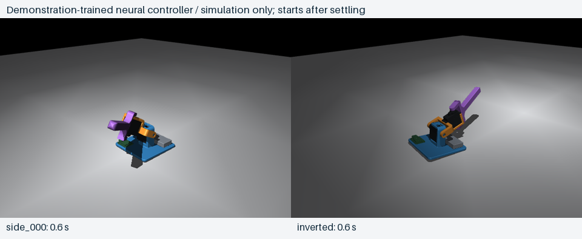

# Simulation recovery controller

Recorded **1 November 2026**. Codex leads this work autonomously; physical observations will be requested when required for calibration. The current result is a **demonstration-trained neural controller that recovers in the tested simulator**. It has not been flashed to the robot.



[Watch the neural-controller animation](results/neural_recovery.gif), or compare the [searched waypoint motions](results/searched_recovery.gif). These use separate controllers: the neural animation evaluates the saved network in closed loop; the searched animation replays optimized open-loop target sequences.

## Results

| Experiment | Result |
|---|---:|
| Searched recovery motions, nominal model | 9/9 standardized fallen starts |
| Zero-action baseline on those fallen starts | 0/9 |
| Successful, audited demonstration collection | 71/80 attempts, including upright holds |
| Randomized attempts within that collection | 61/70 |
| Selected neural controller, nominal evaluation | 10/10, including upright |
| Selected neural controller, development variations | 10/10 |
| Separate held-out scripted-case trials | 30/30 |
| Broader held-out random-pose trials | 100/100 |
| Broad trials also passing adjacent-overlap screening | 100/100 |
| Broad-test median / maximum control time | 3.41 s / 5.24 s |

Success requires the base to be within 10° of upright, both joints near neutral, low angular rate and base-floor contact for **one continuous second**. Times include that dwell and exclude the 0.8 s settling period before control. The zero-action policy succeeds only on the initially upright case in the ten-case nominal suite. Raw results and limitations are in [summary.json](results/summary.json), [training_report.json](results/training_report.json), and [broad_evaluation.json](results/broad_evaluation.json).

The selected checkpoint is **behavior cloning**, not the PPO-refined checkpoint. PPO refinement was actually run for **67,584 transitions** and evaluated at intervals; none improved the demonstration-trained checkpoint on the nominal/development sets. Retaining the stronger earlier checkpoint avoids presenting a worse PPO result as progress. The same network remains compatible with the PPO training/export pipeline for later refinement.

## How it was built

1. Replaced the two servo collision boxes with 43 convex pieces derived from their CAD. The earlier boxes falsely overlapped the horn brackets. There are now 337 convex collision meshes overall, plus battery/board boxes; see the [model notes](../onshape/README.md).
2. Searched six two-joint target waypoints with cross-entropy optimization: 32 candidates × 5 iterations for each of eight side/diagonal rotation axes and an inverted request, seed 17. Knots are 0.5 s apart, followed by return-to-neutral and a 1.5 s hold. Every target passes through the environment's incremental action contract, finite servo response and torque bounds; joint angles are not teleported.
3. Screened every selected trajectory in a second static model with adjacent contacts enabled. The audit ignores the shaft/bore mating region within 6 mm of each hinge line and flags overlap deeper than 1 mm elsewhere. All nine passed.
4. Replayed those motions plus upright holds, with nominal and randomized attempts, collecting only successes that also passed the audit. The dataset contains **71 complete trajectories / 13,750 observation-action pairs**. Perturbations include start pose, mass, friction, servo speed/torque/gain/delay and observation noise. These are exploratory ranges, not measured physical uncertainty.
5. Trained the 10→64→64→2 tanh actor for 3,000 minibatch updates. Validation holds out complete trajectories, rather than randomly mixing neighboring frames between train and validation. Closed-loop recovery results are evaluated separately from supervised prediction error.
6. Compared PPO refinement against that checkpoint using nominal/development trials. Final scripted-case test seeds (5000 onward) and broader random-pose seeds (9000 onward) were kept out of checkpoint selection. This is one training seed, not a multi-seed learning benchmark.
7. Exported the selected actor to portable C and verified it against SB3 on **2,000 inputs**: 1,000 synthetic inputs and 1,000 sampled demonstration observations. Maximum absolute output difference was **4.17×10⁻⁷**. The actor has **4,994 float32 parameters / 19,976 bytes of weights**. This checks host mathematics, not MCU latency. The separate [embedded probe](../../firmware/policy_probe/README.md) builds this actor for the XIAO without generating servo pulses; it has not been uploaded.

The learning framework is [Stable-Baselines3 2.4 PPO](https://stable-baselines3.readthedocs.io/en/v2.4.0/modules/ppo.html), with a project-owned supervised actor initialization. Tested training versions are Python 3.12, PyTorch 2.5.1, SB3 2.4.0, Gymnasium 1.0.0, MuJoCo 3.2.6 and NumPy 1.26.4 on Apple Silicon. A separate `.venv-sim` keeps these dependencies independent from CAD tooling.

## What the test coverage means

Every reset starts with neutral joints and places the requested base orientation just above the floor, then lets the robot settle for 0.8 s before control. An inverted straight-arm robot often tips onto its side during that settling. The stored initial qpos values and videos show the states actually controlled. The nine named starts are therefore **requested poses followed by settling**, not proof of recovery from every possible inverted joint configuration.

The broad test samples requested tilt uniformly over `[0, π]` and horizontal rotation-axis azimuth over `[0, 2π]`, then settles them, with the existing parameter randomization. This is not a uniform SO(3) sample. It does not vary initial joint configurations, floor shape or all possible contacts. A finite set of 100 successes does not establish an always-recover guarantee.

The actor still receives simulation orientation truth plus noise as its DOWN vector. The real IMU estimator, sensor-to-base alignment, PWM-angle signs/limits, loaded servo response, actual mass distribution and MCU timing are not calibrated/integrated. Adjacent contacts remain excluded during dynamics; snapshot screening is a useful extra check, not a substitute for validated mechanical stops or selective contact dynamics. Hardware validation is consequently still outstanding.

## Saved artifacts

- [policy_simulation_only.zip](results/policy_simulation_only.zip): selected SB3 checkpoint, explicitly retained in Git despite the general ZIP ignore rule.
- [policy_simulation_only.h](results/policy_simulation_only.h): portable actor weights/inference, included only by the separate arithmetic probe; the robot controller does not use it.
- [policy_contract.json](results/policy_contract.json): input order, units, action integration and current angle limits for this checkpoint.
- [policy_simulation_only.json](results/policy_simulation_only.json): compiled-C parity and artifact hashes.
- [demonstrations.npz](results/demonstrations.npz) and [metadata](results/demonstrations.json): successful simulation observations/actions and episode IDs; the metadata also records failed collection attempts.
- [trajectory_search.json](results/trajectory_search.json) and [searched_traces](results/searched_traces): search configuration/history, selected waypoints and full-state replays.
- [neural_traces](results/neural_traces): actual network-controlled rollouts used for the neural animation.
- [artifact_validation.json](results/artifact_validation.json): hash, dataset-shape, metric and numerical-state consistency checks.

All inference inputs are hardware-observable estimates/commands: gravity direction, gyro, commanded targets and previous actions. Simulated actual joint angles and contacts are used for servo physics, reward, audit and visualization, not as actor inputs. No firmware upload or physical robot command was performed for these experiments. The requested battery LED remains a future-development note.

## Reproduce or continue

From the repository root, use Python 3.12 and install `requirements-train.txt` into `.venv-sim` (or use the existing environment). With the available `uv` tool:

```sh
uv venv --python 3.12 .venv-sim
uv pip install --python .venv-sim/bin/python -r sim/recovery/requirements-train.txt

# Check the committed artifacts without retraining.
.venv-sim/bin/python sim/recovery/check_results.py

# Replay the saved neural controller in simulation and render it.
.venv-sim/bin/python sim/recovery/replay.py sim/recovery/results/policy_simulation_only.zip
.venv-cad/bin/python sim/recovery/render.py runs/neural_replay/report.json \
  --out runs/neural_replay/recovery.gif --title 'Neural controller / simulation only'

# Recreate the demonstrated training experiment.
.venv-sim/bin/python sim/recovery/learn.py sim/recovery/results/demonstrations.npz \
  --bc-updates 3000 --ppo-steps 65536 --envs 3 --out runs/recovery_policy
```

`learn.py` uses spawned workers and CPU inference/training. PPO completes whole rollouts, so 65,536 requested transitions became 67,584 actual transitions here. Native Mac graphics access is required for rendering; the scripts contain no hardware control.

The full search/collection commands are:

```sh
.venv-cad/bin/python sim/recovery/search.py \
  --cases side_000 side_045 side_090 side_135 side_180 side_225 side_270 side_315 inverted \
  --population 32 --iterations 5 --workers 3 --out runs/recovery_search_seed17
.venv-cad/bin/python sim/recovery/audit.py runs/recovery_search_seed17/report.json
.venv-cad/bin/python sim/recovery/collect.py runs/recovery_search_seed17/report.json \
  --repeats 8 --out runs/recovery_demos_seed17
```

Once sensing and actuator calibration are available, Codex will update the simulator/firmware contract, retrain or refine against those measurements, and compare real and simulated behavior. The user's help is needed for physical observations that the current three-wire servos and USB connection cannot provide, rather than for taking over implementation.
